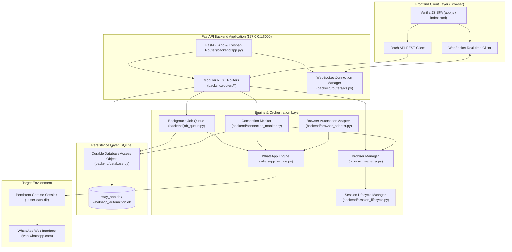
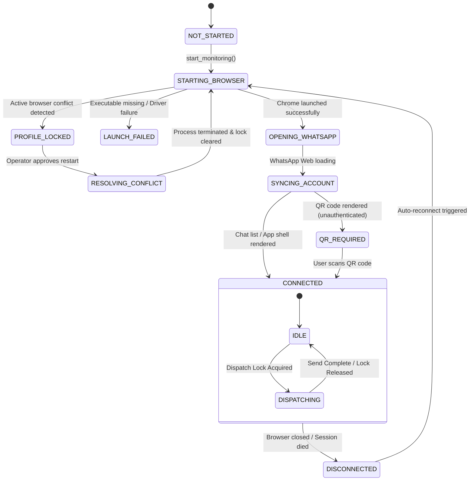
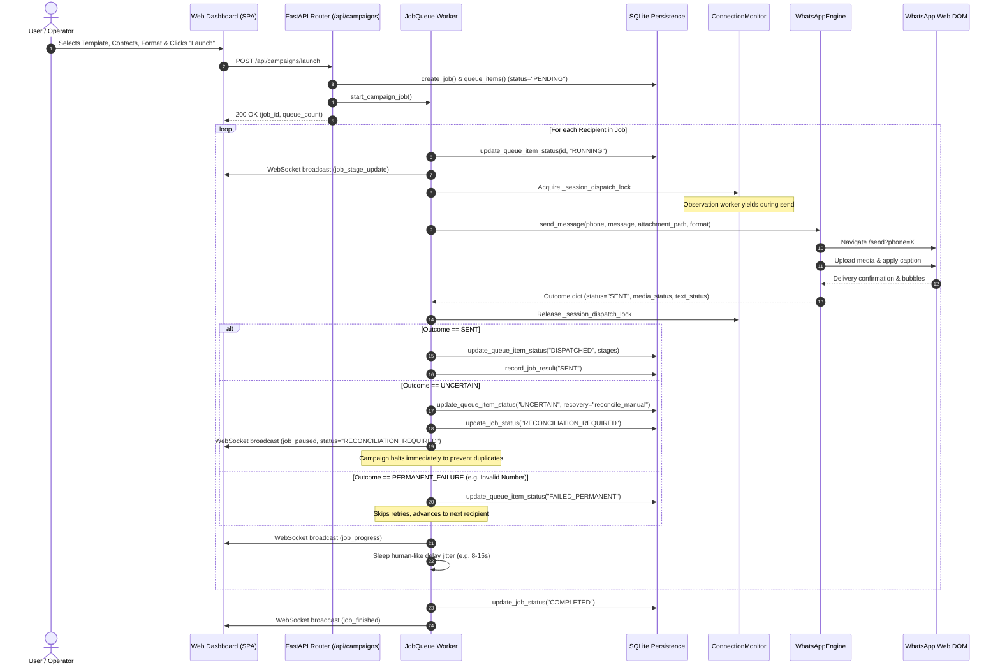
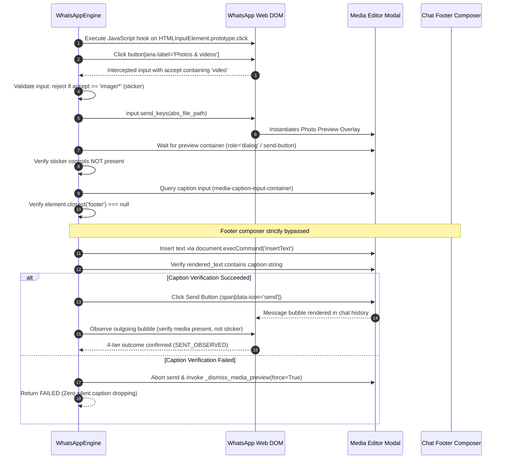
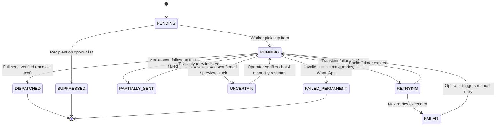

# Relay System Architecture & Component Specification

This document provides a comprehensive technical specification of Relay's architecture, component boundaries, data flow pipelines, and runtime state management. Every component and interaction described here reflects the active codebase.

---

## 1. High-Level Architectural Overview

Relay is built as an asynchronous local client-server automation system designed for reliable, auditable WhatsApp communication. It combines a FastAPI REST/WebSocket backend with an isolated SQLite data layer, a vanilla JavaScript single-page application (SPA) frontend, and a dedicated Selenium WebDriver automation harness controlling persistent Chromium browser sessions.

---

## 2. Core Subsystems and Component Responsibilities

### 2.1 Backend Server (`backend/app.py` & `backend/routers/*`)
- **FastAPI Core**: Binds to `127.0.0.1:8000` (isolated local loopback). Handles CORS policies strictly limited to localhost origins (`http://127.0.0.1:8000`, `http://localhost:8000`, `http://127.0.0.1:5173`).
- **Application Lifespan**: Manages startup initialization, durable database migration checks, active session recovery, and safe background shutdown.
- **Modular Routers**:
  - `browser.py`: Controls profile detection, connection health checks, remote driver launches, screenshots, conflict resolution, and non-sending UI verification.
  - `campaigns.py`: Manages campaign draft creation, pre-flight validation, allocation dry-runs, and execution staging.
  - `contacts.py`: Imports and cleans CSV/XLSX contacts, deduplicates numbers, and enforces suppression/opt-out rules.
  - `jobs.py`: Handles campaign job queueing, per-recipient activity logs, pause/resume commands, manual retry triggers, and CSV report exports.
  - `media.py`: Manages uploaded media assets, MIME validation, thumbnail generation, hash-based deduplication, and file removal.
  - `templates.py`: Governs message templates, multi-text variations, Spintax parsing, variable interpolation, and media attachments.
  - `sets.py` & `collections.py`: Manages curated content sets and multi-asset collections.
  - `config.py` & `logs.py`: Manages operational presets, anti-ban thresholds, and queryable audit logs.
  - `ws.py`: Broadcasts live state events (connection state transitions, progress updates, recipient results).

### 2.2 Frontend Architecture (`backend/static/app.js` & `backend/static/index.html`)
- **Single Page Application (SPA)**: Lightweight, dependency-free vanilla JavaScript organized into modular UI sections (Dashboard, Contacts, Templates, Campaigns, Activity, System Logs, Settings).
- **Two-Way State Synchronization**:
  - **REST Layer**: Communicates with FastAPI endpoints using `fetch` with standardized error wrapping (`_build_structured_error`).
  - **WebSocket Event Listener**: Ingests push events (`connection_state_changed`, `job_progress`, `job_stage_update`, `job_paused`, `job_finished`) to update UI progress bars, recipient activity drawers, and connection health badges in real time without polling.
- **Activity Drawer**: Provides deep forensic inspection for each recipient in a campaign: Media Status, Text Status, Overall Status, Recovery Action, and error diagnostics.

### 2.3 Persistence Layer (`backend/database.py`)
- Thread-safe SQLite access managed via context managers and process-level threading locks (`_lock`).
- **Key Tables**:
  - `jobs`: Stores campaign execution records, timing configurations, overall status, sent/failed/suppressed counts, and error details.
  - `queue_items`: Tracks individual recipient tasks within a campaign with deterministic idempotency keys, per-stage delivery statuses (`media_status`, `text_status`, `overall_status`), and recovery eligibility tags (`retry_all`, `retry_text_only`, `reconcile_manual`, `none`).
  - `job_results`: Permanent historical delivery logs for completed campaign runs.
  - `contacts` & `suppression_list`: Cleaned phone numbers, names, tags, and opt-out records.
  - `templates` & `template_variants`: Master message definitions and child text variations.
  - `media_assets`: Uploaded media files, content hashes (`SHA256`), file sizes, and MIME types.
  - `system_logs`: System audit trail with severity levels (`INFO`, `WARNING`, `ERROR`).

### 2.4 Browser & Session Management (`browser_manager.py` & `backend/session_lifecycle.py`)
- **BrowserManager**:
  - Detects installed Chromium browsers (Chrome, Edge, Brave) and inspects Windows Registry / AppData paths.
  - Enforces Chromium 136+ security policies: warns when default user data directories cannot be attached via remote debugging, and provisions isolated persistent sessions (`__dedicated__`).
  - Employs cached driver binary resolution (`_find_cached_service`) across local Selenium caches (`~/.cache/selenium/chromedriver/...`) and `PATH` to eliminate remote download stalls.
  - Provides rigorous lockfile diagnosis (`diagnose_profile`) to identify active PIDs, differentiate Relay-owned vs. personal browser windows, and clean up stale lock files.
- **SessionLifecycle**:
  - Generates immutable session IDs, saves PID state to `session_lifecycle.json`, and handles graceful process termination.

### 2.5 Connection Monitoring (`backend/connection_monitor.py`)
- **Continuous Observation**: Background thread (`ConnectionMonitor-Observer`) actively monitors the live Selenium WebDriver session.
- **State Machine**: Transitions across `NOT_STARTED` &rarr; `STARTING_BROWSER` &rarr; `OPENING_WHATSAPP` &rarr; `SYNCING_ACCOUNT` &rarr; `QR_REQUIRED` &rarr; `CONNECTED` &rarr; `DISCONNECTED` / `PROFILE_LOCKED` / `LAUNCH_FAILED`.
- **Concurrency Isolation**: Yields WebDriver access whenever an active dispatch holds `_session_dispatch_lock`, completely preventing monitoring contention during message sending.

### 2.6 Automation Engine (`whatsapp_engine.py`)
- **WhatsAppEngine**:
  - Encapsulates low-level Selenium WebDriver operations on `web.whatsapp.com`.
  - Implements multi-tiered selector lists for navigation, chat opening, file upload, caption entry, send triggers, and bubble verification.
  - Strictly distinguishes "Photos & videos" inputs from "New sticker" inputs.
  - Implements zero-silent-drop caption enforcement: guarantees caption text is rendered in the media preview modal before sending; aborts if the caption cannot be inserted.
  - Employs a 4-tier outcome verification model: `FAILED_TRANSMISSION`, `UNCERTAIN`, `SENT_UNCONFIRMED`, and `SENT_OBSERVED`.

### 2.7 Background Job Queue Worker (`backend/job_queue.py`)
- **BackgroundJobWorker**:
  - Orchestrates sequential recipient execution with anti-ban pacing jitter (configurable min/max delays, batch cooldown pauses, and daily volume caps).
  - Handles Spintax parsing (`{Hi|Hello|Hey}`) and variable substitution (`{name}`).
  - Enforces atomic dispatch locks (`_session_dispatch_lock`) to prevent race conditions.
  - Automatically isolates transient failures from permanent invalid numbers.
  - Immediately transitions campaigns to `RECONCILIATION_REQUIRED` upon any unconfirmed or `UNCERTAIN` send, halting subsequent dispatches to protect against duplicate messaging.

---

## 3. System Lifecycle & Interaction Diagrams

### 3.1 Browser Session Lifecycle

The following state diagram details how Relay initializes, monitors, and recovers browser sessions.

---

### 3.2 Template-to-Recipient Dispatch Pipeline

The following sequence diagram illustrates the lifecycle of a campaign dispatch from user configuration to database persistence.

---

### 3.3 Media and Caption Transmission Pipeline

This diagram illustrates the precise browser-level steps required to transmit a photo with an attached caption without sticker conversion or caption detachment.

---

### 3.4 Queue Item State Machine

The following state diagram depicts the lifecycle and recovery routes of an individual recipient queue item in SQLite.

---

## 4. Key Subsystem Interactions & Guarantees

1. **Anti-Contention Guarantee**:
   The `ConnectionMonitor` background thread checks browser health every 1.8 seconds. However, during live dispatch, the `BackgroundJobWorker` acquires `_session_dispatch_lock`. When this lock is held, `ConnectionMonitor` yields immediately without invoking Selenium commands, eliminating any driver collisions.
2. **Duplicate Protection Guarantee**:
   Whenever a message status cannot be conclusively proven (e.g., preview modal did not cleanly dismiss, or network receipt was not observed), the system records `status="UNCERTAIN"` and halts the campaign with `RECONCILIATION_REQUIRED`. The worker never auto-repeats an uncertain send.
3. **Caption Integrity Guarantee**:
   If a campaign specifies a caption for an image, Relay validates that the text is physically rendered in the media preview editor prior to clicking Send. If the caption input cannot be located or verified, Relay aborts the send, closes the preview, and marks the item `FAILED`, ensuring captions are never silently discarded.
