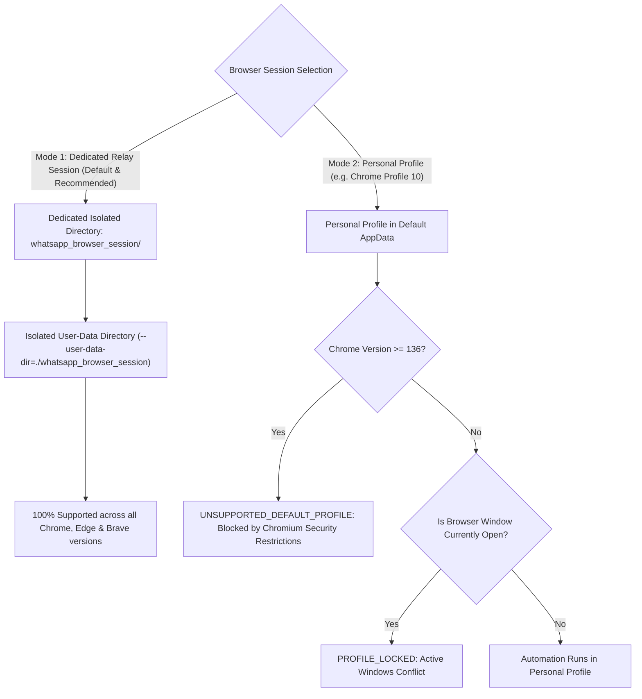
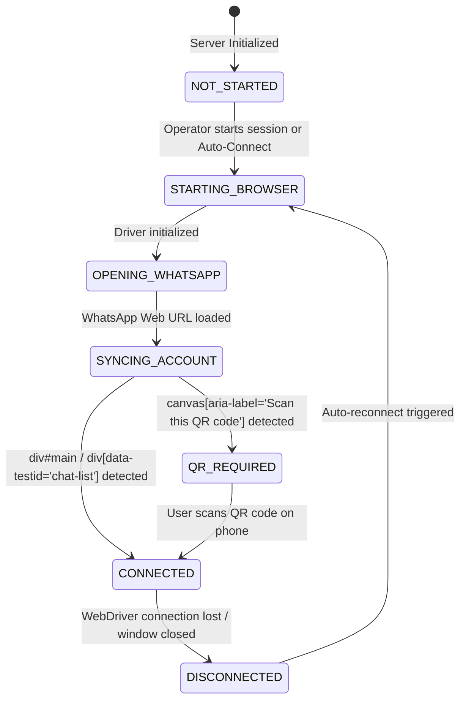

# Browser Session Architecture & Connection Management

This document details the configuration, persistence, locking mechanics, authentication tracking, and operational mitigations of Relay's browser automation layer (`browser_manager.py`, `backend/connection_monitor.py`, `backend/session_lifecycle.py`).

---

## 1. Supported Session Modes

Relay provides two distinct modes for managing WhatsApp Web browser sessions:



### 1.1 Mode 1: Dedicated Relay Session (`__dedicated__`)
- **Directory**: `whatsapp_browser_session/` inside the Relay application root directory.
- **Benefits**:
  - Completely isolated from the operator's personal browsing data, extensions, and bookmarks.
  - WhatsApp Web credentials (indexedDB, localStorage, service workers) persist across application restarts; **operators only scan the QR code once**.
  - Immune to Chromium 136+ security restrictions regarding remote debugging on default user-data directories.
  - Supports simultaneous personal browsing while Relay automation executes.

### 1.2 Mode 2: Existing Personal Profiles
- Allows targeting personal browser profiles (e.g., `Default`, `Profile 1`, `Profile 10`) under `%LOCALAPPDATA%\Google\Chrome\User Data`.
- **Chromium 136+ Security Barrier**: Modern Chromium versions strictly prohibit attaching remote debugging harnesses (`--remote-debugging-port`) or launching WebDriver instances against the default user-data directory if personal Chrome windows are active. Relay automatically detects this condition and routes the operator to the dedicated session.

---

## 2. Browser Startup & Anti-Detection Configuration

WebDriver instances are launched with specific command-line arguments and capabilities designed to prevent bot detection and preserve responsive layout rendering:

```python
# browser_manager.py - launch_driver
options = ChromeOptions()
options.add_argument(f"--user-data-dir={profile_path}")

# Anti-detection flags
options.add_argument("--disable-blink-features=AutomationControlled")
options.add_argument("--disable-infobars")
options.add_experimental_option("excludeSwitches", ["enable-automation"])
options.add_experimental_option("useAutomationExtension", False)

# Viewport stability flags
options.add_argument("--start-maximized")
options.add_argument("--window-size=1920,1080")
options.add_argument("--no-sandbox")
options.add_argument("--disable-dev-shm-usage")

# Optional headless mode
if headless:
    options.add_argument("--headless=new")
```

### 2.1 Viewport Requirements & Headless Differences
- WhatsApp Web dynamically reflows its user interface based on viewport width:
  - Below 1024px: The conversation list collapses into a mobile drawer, hiding message action menus and attachment buttons.
  - 1920x1080 (Headed or `--headless=new`): Both the conversation pane and chat history remain persistently visible and accessible to Selenium selectors.
- Relay explicitly sets `--window-size=1920,1080` in both headed and headless modes to prevent layout shifts.

---

## 3. Profile Locking & Conflict Resolution

Windows enforces mandatory file locks on SQLite/LevelDB databases within an active Chromium user-data directory. Attempting to start WebDriver against an actively locked profile causes immediate process crashes.

### 3.1 Pre-Flight Diagnosis (`BrowserManager.diagnose_profile`)
Before launching any driver, Relay inspects the target profile:
1. **Lockfile Analysis**: Checks for `lockfile` / `Parent.lock`.
2. **Process Scan**: Uses `psutil` to inspect all running `chrome.exe`, `msedge.exe`, and `brave.exe` processes.
3. **PID Matching**: Correlates process command lines (`--user-data-dir`) against the target path.
4. **Relay Ownership Tagging**: Inspects `session_lifecycle.json` to verify if the active process belongs to a previous Relay session (`relay_owned`) or the operator's personal browser (`personal_browser`).

### 3.2 Conflict Resolution Policies
- **Relay-Owned Process**: If a previous Relay process remained active (e.g., after an unexpected shutdown), Relay terminates the orphaned process tree automatically without prompting the user.
- **Personal Browser Window**: If an operator has their personal browser open on the selected profile, Relay sets `state=PROFILE_LOCKED`, informs the user in the UI, and offers a safe prompt before touching any process.
- **Stale Lock Artifacts**: If a lock file exists on disk but no corresponding browser process is alive, Relay classifies the condition as `STALE_LOCK` and allows the operator to launch anyway.

---

## 4. Connection State Tracking (`backend/connection_monitor.py`)

The background observer (`ConnectionMonitor-Observer`) checks the live browser state every 1.8 seconds using a non-intrusive timeline model:



### 4.1 Dispatch Contention Mitigation
During campaign dispatch, high-frequency DOM queries from the connection monitor can interfere with active message sending. Relay isolates this using `_session_dispatch_lock`:
- Whenever `WhatsAppEngine` is sending a message or attaching media, it holds `_session_dispatch_lock`.
- `ConnectionMonitor` detects this lock and pauses observation ticks until dispatch completes, ensuring zero contention.

---

## 5. Summary of Historical Failures and Active Mitigations

| Historical Problem | Confirmed Root Cause | Implemented Engineering Mitigation |
|---|---|---|
| **Chrome Launch Hang (3+ mins)** | Selenium Manager attempting remote network calls to Google CDN for driver downloads. | `_find_cached_service` resolves local cached `chromedriver.exe` in `~/.cache/selenium/...`, launching in 1.4s. |
| **Unsupported Profile Crash** | Chromium 136+ security restrictions blocking remote debugging on default profile. | `BrowserManager.diagnose_profile` flags `UNSUPPORTED_DEFAULT_PROFILE` and defaults to isolated `__dedicated__` session. |
| **False Disconnection Alerts** | Monitoring thread checking during heavy page reloads. | Multi-tier DOM selectors + 3-tick confirmation threshold before declaring session disconnected. |
| **Driver Lock Collisions** | Connection monitor and job worker executing Selenium commands concurrently. | `_session_dispatch_lock` yields observation worker during all outbound dispatches. |
| **Mobile Drawer Collapse in Headless** | Default headless viewport was too small, hiding chat composer. | Forced `--window-size=1920,1080` and `--start-maximized` flags. |
