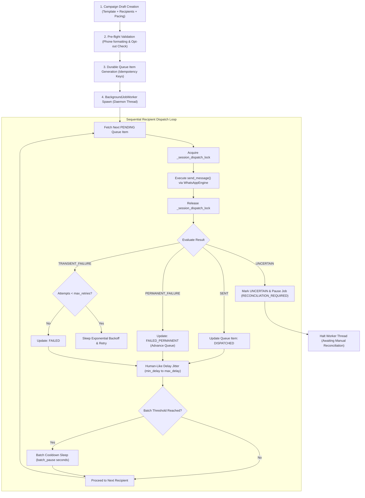
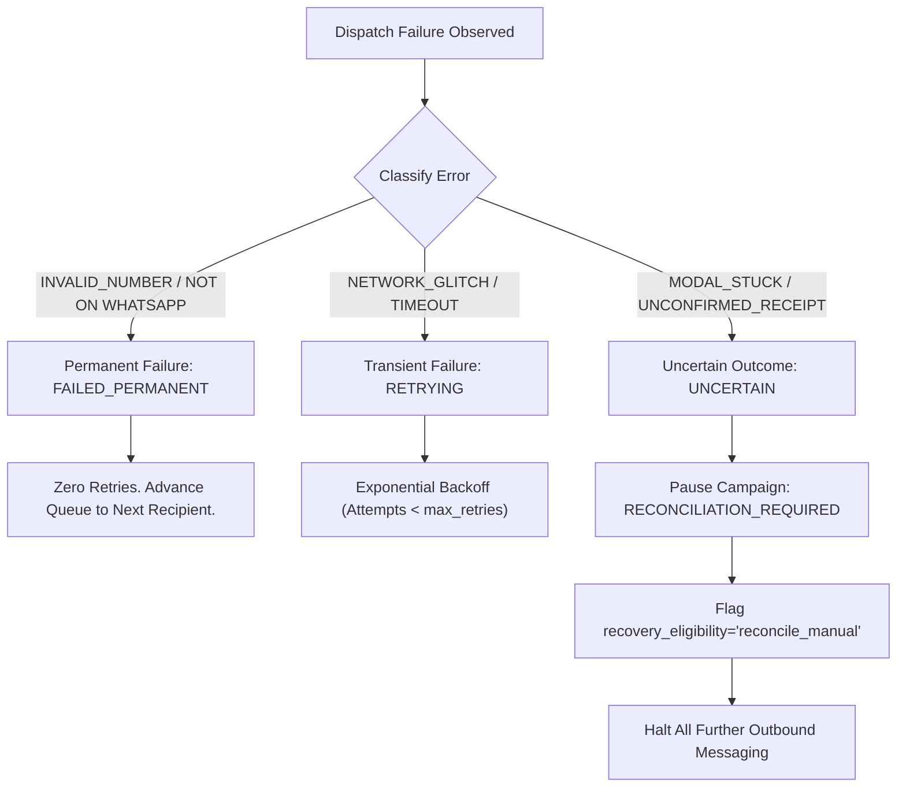

# Campaign Dispatch Engine & Recovery Architecture

This document describes the design, execution lifecycle, queue management, anti-ban pacing mechanisms, and error recovery policies of Relay's Campaign Dispatch Engine (`backend/job_queue.py`).

---

## 1. Campaign Execution Lifecycle

The dispatch lifecycle transforms high-level user campaign configurations into sequential, paced, browser-level automation actions with durable database checkpoints.



---

## 2. Pacing, Anti-Ban Controls & Jitter

WhatsApp actively monitors automated and high-frequency messaging patterns. Relay implements strict anti-ban pacing safeguards:
1. **Randomized Delay Jitter (`min_delay` to `max_delay`)**:
   Between consecutive recipients, the worker computes a randomized sleep interval:
   $$\Delta t = \text{random.uniform}(\text{min\_delay}, \text{max\_delay})$$
   Default range: 8.0 to 15.0 seconds.
2. **Batch Cooldown Pauses (`batch_size` & `batch_pause`)**:
   After dispatching `batch_size` messages (default: 20 recipients), the worker halts for a cooldown pause of `batch_pause` seconds (default: 60.0 to 90.0 seconds).
3. **Daily Volume Caps (`daily_cap`)**:
   Enforces a strict ceiling on outgoing messages per 24-hour cycle (default: 100 to 250). If the cap is reached, the worker pauses execution until the next day.
4. **Spintax Variation & Dynamic Interpolation**:
   Resolves curly-bracket Spintax (e.g. `{Hello|Hi|Greetings}`) and contact variables (`{name}`, `{phone}`) so that message payloads are textually distinct.

---

## 3. Session Ownership & Concurrency Locking

To prevent race conditions between background health monitoring and active dispatch:
- **`_session_dispatch_lock = threading.Lock()`**:
  A global process-level mutex.
- When `BackgroundJobWorker` begins communicating with `WhatsAppEngine`, it acquires `_session_dispatch_lock`.
- `ConnectionMonitor._observation_worker` queries this lock on each observation tick (1.8s). If the lock is held, `ConnectionMonitor` yields immediately:
  ```python
  # backend/connection_monitor.py
  if _session_dispatch_lock.locked():
      logger.debug("Dispatch lock held by active messaging job. Observation worker yielding...")
      time.sleep(1.5)
      continue
  ```
- This guarantees that WebDriver commands never interleave.

---

## 4. Supported Messaging Formats

Relay supports two distinct delivery formats, configured per campaign:

### 4.1 Format A: `image_with_caption` (Default & Recommended)
- **Behavior**: The media file is uploaded to the Photos & Videos file input, the caption is typed directly into the media editor modal (`media-caption-input-container`), and a single Send command transmits both the photo and text as **one unified message bubble**.
- **Delivery Tracking**:
  - `media_status`: `"SENT"`
  - `text_status`: `"SENT"`
  - `overall_status`: `"SENT"`
- **Failure Isolation**: If caption insertion fails, the send is aborted (`FAILED`). No orphaned text or uncaptioned image is transmitted.

### 4.2 Format B: `image_then_text`
- **Behavior**: Used when the operator prefers sending a standalone high-resolution photo followed by a detailed separate text message.
  1. Dispatches media attachment without caption.
  2. Verifies media bubble transmission.
  3. Dispatches text message through the standard conversation composer.
- **Independent Status Tracking**:
  - If both succeed: `media_status="SENT"`, `text_status="SENT"`, `overall_status="SENT"`.
  - If media succeeds but text fails:
    - `overall_status = "PARTIALLY_SENT"`
    - `last_successful_stage = "media"`
    - `recovery_eligibility = "retry_text_only"`
- **Text-Only Retry Mode**: When retrying a `PARTIALLY_SENT` item, Relay skips media upload and transmits only the remaining text message, eliminating duplicate media delivery.

---

## 5. Failure Classification & Safe Recovery Rules



### 5.1 Why Uncertain Sends Must NEVER Auto-Repeat
If a transmission is flagged `UNCERTAIN` (for example, the preview overlay lingered or the browser did not confirm a checkmark before timeout):
1. **The message may already have been delivered to the recipient's phone.**
2. Auto-retrying an uncertain send risks sending duplicate business messages to customers.
3. Therefore, Relay:
   - Sets `status="UNCERTAIN"`.
   - Sets `recovery_eligibility="reconcile_manual"`.
   - Transitions the campaign job status to `RECONCILIATION_REQUIRED`.
   - Halts the worker loop immediately.
   - Requires the operator to inspect the chat history before clicking Resume.

---

## 6. Durable Database Schema Reference

### 6.1 `jobs` Table
| Column | Type | Description |
|---|---|---|
| `id` | `TEXT PRIMARY KEY` | UUID string identifying the campaign job run. |
| `campaign_name` | `TEXT` | Human-readable campaign name. |
| `status` | `TEXT` | `PENDING`, `RUNNING`, `PAUSED`, `RECONCILIATION_REQUIRED`, `COMPLETED`, `FAILED`, `CANCELLED`. |
| `total_count` | `INTEGER` | Total number of recipient items queued. |
| `sent_count` | `INTEGER` | Count of successfully delivered recipients. |
| `failed_count` | `INTEGER` | Count of failed or uncertain recipients. |
| `skipped_count` | `INTEGER` | Count of suppressed or invalid numbers. |
| `min_delay` | `REAL` | Minimum delay between recipients (seconds). |
| `max_delay` | `REAL` | Maximum delay between recipients (seconds). |
| `batch_size` | `INTEGER` | Recipients dispatched before cooldown pause. |
| `batch_pause` | `REAL` | Duration of batch cooldown pause (seconds). |
| `daily_cap` | `INTEGER` | Maximum dispatches allowed in 24 hours. |
| `attachment_path`| `TEXT` | Absolute path to media asset on disk. |
| `message_format` | `TEXT` | `"image_with_caption"` or `"image_then_text"`. |

### 6.2 `queue_items` Table
| Column | Type | Description |
|---|---|---|
| `id` | `INTEGER PRIMARY KEY`| Auto-increment item identifier. |
| `job_id` | `TEXT` | Foreign key referencing `jobs.id`. |
| `recipient_phone`| `TEXT` | Cleaned international phone number. |
| `recipient_name` | `TEXT` | Contact name for variable substitution. |
| `resolved_message`| `TEXT` | Final interpolated message after Spintax resolution. |
| `status` | `TEXT` | `PENDING`, `RUNNING`, `DISPATCHED`, `UNCERTAIN`, `PARTIALLY_SENT`, `FAILED_PERMANENT`, `FAILED`. |
| `idempotency_key`| `TEXT UNIQUE` | SHA256 hash preventing duplicate queue insertion. |
| `media_status` | `TEXT` | Stage outcome: `"SENT"`, `"FAILED"`, `"SKIPPED"`, `"UNCERTAIN"`. |
| `text_status` | `TEXT` | Stage outcome: `"SENT"`, `"FAILED"`, `"SKIPPED"`, `"UNCERTAIN"`. |
| `overall_status` | `TEXT` | Unified delivery state. |
| `last_successful_stage`| `TEXT`| `"none"`, `"media"`, `"text"`, `"caption"`. |
| `recovery_eligibility` | `TEXT`| `"none"`, `"retry_all"`, `"retry_text_only"`, `"reconcile_manual"`. |
