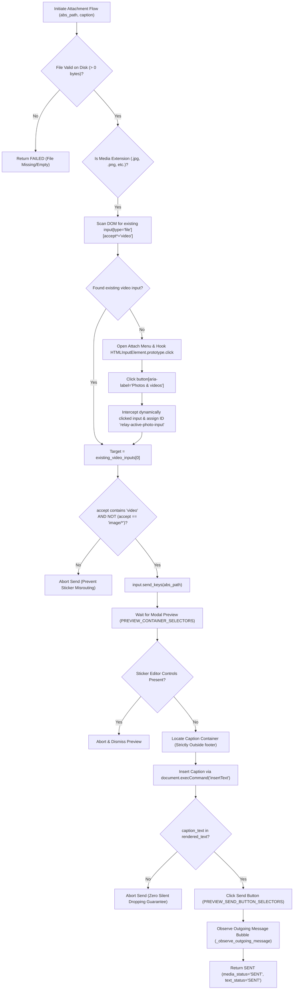

# WhatsApp Media & Caption Delivery Pipeline

This document details the engineering history, root-cause forensics, architectural design, and implementation specifics of Relay's media and caption delivery pipeline. It specifically explains the resolution of the "Sticker Bug" and the DOM interception mechanisms used to achieve 100% reliable image-with-caption dispatch on WhatsApp Web.

---

## 1. Executive Summary & Defect History

During earlier releases of Relay, media dispatches encountered an elusive bug:
- Outgoing image files were converted into **WhatsApp Stickers** instead of normal photographic images.
- Text captions failed to appear on the sent media and were either dropped completely or dispatched as a separate follow-up text bubble.
- The automation engine frequently became stuck on the image preview overlay, returning `UNCERTAIN` and halting campaign progression after the first recipient.

### 1.1 Root Cause Forensics

The WhatsApp Web DOM maintains multiple hidden `<input type="file">` elements within its interface:
1. **The Sticker Maker Input**:
   - A static input resident in the DOM: `<input accept="image/*" type="file" style="display: none;">`.
   - When fed an image file directly, WhatsApp Web opens the **Sticker Editor Modal**, an entirely distinct interface with drawing tools, cropping, and background removal—but **no caption input field**.
2. **The Photos & Videos Input**:
   - A dynamically configured input created or activated only when the user clicks the "Photos & videos" attach menu button:
   - Attribute profile: `accept="image/*,video/mp4,video/3gpp,video/quicktime,video/webm,video/x-matroska"`, `multiple=""`.

**The Defect**:
The legacy implementation located file inputs using a naive heuristic:
```python
# Legacy flawed logic
for inp in file_inputs:
    acc = (inp.get_attribute("accept") or "").lower()
    if "image" in acc:
        target_input = inp
        break
```
Because the Sticker Maker input was statically present in the DOM and had `accept="image/*"`, the loop selected it every time for standard `.jpg` and `.png` images.

### 1.2 Cascading Consequences
- **Sticker Transformation**: Ordinary business photos and brochures were rendered in chat as sticker thumbnails (`alt="Sticker"`).
- **Caption Detachment**: Because the sticker modal contains no caption element, the legacy fallback selector `footer div[contenteditable='true']` located the background chat composer underneath the modal. The caption was typed into the background composer.
- **Preview Overlay Lingering**: After clicking the sticker send button, WhatsApp Web's modal animation differed from standard media previews. Relay's dismiss routine timed out waiting for the standard preview container to vanish, concluding with an `UNCERTAIN` transmission state.
- **Queue Interruption**: To protect against duplicate messaging, Relay's queue paused upon `UNCERTAIN` sends, preventing subsequent recipients from being processed.

---

## 2. The Current Working Implementation

The current working implementation in `whatsapp_engine.py` (`_send_attachment_flow`) resolves this defect through a multi-stage validation and interception architecture.



---

## 3. Deep-Dive: Dynamic Input Interception via `HTMLInputElement.prototype.click`

### 3.1 Why Interception is Necessary
WhatsApp Web's React architecture does not keep the "Photos & videos" file input in the top-level DOM at all times. When the user clicks the "Photos & videos" button in the attach flyout menu, WhatsApp dynamically creates or assigns a file input and programmatically triggers its `.click()` method inside an event handler to launch the native OS file picker.

In Selenium, standard WebDriver cannot interact with native OS file dialogs. The only way to upload a file is to call `WebElement.send_keys(file_path)` directly on the `<input type="file">` element.

### 3.2 Implementation Mechanics
Relay injects an inline JavaScript hook immediately before clicking the "Photos & videos" button:

```javascript
var btn = document.querySelector("button[aria-label='Photos & videos'], div[role='button'][aria-label='Photos & videos']");
if (!btn) return { error: "Photos & videos button not found" };

var targetInput = null;
var origClick = HTMLInputElement.prototype.click;

// Intercept the programmatic click
HTMLInputElement.prototype.click = function() {
    targetInput = this;
    this.id = 'relay-active-photo-input';
    this.style.display = 'block';
    this.style.visibility = 'visible';
    this.style.opacity = '1';
};

try {
    btn.click();
} finally {
    // Strictly restore the original prototype click immediately
    HTMLInputElement.prototype.click = origClick;
}

return {
    success: targetInput !== null,
    accept: targetInput ? targetInput.getAttribute('accept') : null
};
```

### 3.3 Safety and Cleanup Guarantees
- **Scoped `try ... finally`**: The monkey-patched prototype method is restored in the `finally` block synchronously. Even if `btn.click()` throws an exception, `HTMLInputElement.prototype.click` is never left in a hijacked state.
- **Zero Global Side Effects**: Native user clicks or subsequent script executions in WhatsApp Web operate with standard, unmodified browser prototypes.

### 3.4 Diagnostic Signatures for Future WhatsApp Web DOM Changes
If WhatsApp alters its attach menu structure in future releases, inspect:
1. `btn` selector: Check if `aria-label` changes from `'Photos & videos'` to localized strings or new icons.
2. File input `accept` patterns: Verify if WhatsApp begins using `accept="*"` or distinct MIME categories.
3. DOM ancestry: Confirm that the file input remains an `HTMLInputElement` instance.

---

## 4. Modal-Scoped Caption Handling & Zero Silent Dropping

### 4.1 Strict Exclusion of Chat Footer
The chat footer contains WhatsApp Web's primary message composer:
`<footer ...><div contenteditable="true">...</div></footer>`

Under the sticker bug, captions were injected into this footer because generic selectors like `div[contenteditable='true']` matched the footer before the modal.

Relay enforces a runtime DOM hierarchy guard:
```python
# whatsapp_engine.py
in_footer = self.driver.execute_script(
    "return arguments[0].closest('footer') !== null;", el
)
if in_footer:
    continue  # Strictly ignore! Must NEVER type captions into footer!
```

### 4.2 Caption Input Selectors
The active caption input inside the media preview modal is discovered using prioritized selectors:
```python
CAPTION_INPUT_SELECTORS = [
    (By.CSS_SELECTOR, "div[data-testid='media-caption-input-container'][contenteditable='true']"),
    (By.CSS_SELECTOR, "div[data-testid='media-caption-input-container'] [contenteditable='true']"),
    (By.CSS_SELECTOR, "div[data-testid='media-caption-input-container']"),
    (By.CSS_SELECTOR, "div[data-lexical-editor='true'][contenteditable='true']"),
    (By.CSS_SELECTOR, "div[data-testid='caption-input-box']"),
    (By.CSS_SELECTOR, "div[data-testid='media-editor'] div[contenteditable='true']"),
    (By.CSS_SELECTOR, "div[data-testid='media-preview-container'] div[contenteditable='true']"),
    (By.CSS_SELECTOR, "div[role='dialog'] div[contenteditable='true']"),
    # Additional fallback selectors...
]
```

### 4.3 Zero Silent Dropping Guarantee
If a template or campaign specifies a caption (e.g. `123 automation check`), Relay strictly mandates that the text must physically exist inside the caption element's DOM before dispatch:
```python
rendered = self.driver.execute_script(
    "return (arguments[0].innerText || arguments[0].textContent || '');", c_inp
)
if caption_text in rendered:
    caption_applied = True

if not caption_applied:
    # ZERO SILENT DROPPING: If caption is required but couldn't be applied, abort send!
    self._dismiss_media_preview(force=True, send_action_triggered=False)
    return {
        "status": "FAILED",
        "media_sent": False,
        "caption_sent": False,
        "error": f"Caption could not be inserted into media editor ({caption_text[:30]}). Send aborted to prevent silent dropping."
    }
```

---

## 5. Outgoing Message Observation & Sticker Discrimination

Once the media Send button (`PREVIEW_SEND_BUTTON_SELECTORS`) is clicked, Relay does not blindly assume success. It waits for the modal to dismiss and observes the outgoing chat bubbles:

```python
# whatsapp_engine.py - _get_outgoing_message_data
data = self.driver.execute_script("""
    var results = [];
    var bubbles = document.querySelectorAll("div.message-out");
    bubbles.forEach(function(b) {
        var hasImg = b.querySelector("img") !== null;
        var hasVideo = b.querySelector("video") !== null;
        var isSticker = b.querySelector("img[alt*='Sticker' i]") !== null ||
                        b.querySelector("div[data-testid='sticker-thumb']") !== null;
        var textEl = b.querySelector("span.selectable-text") || b.querySelector("div.copyable-text");
        var text = textEl ? textEl.innerText : "";
        results.push({
            has_media: (hasImg || hasVideo) && !isSticker,
            is_sticker: isSticker,
            text: text
        });
    });
    return results;
""")
```

### 4-Tier Verification Model:
1. `FAILED_TRANSMISSION`: File input not found, preview failed to appear, or caption insertion failed.
2. `UNCERTAIN`: Send button clicked, but preview modal lingered or no outgoing bubble confirmed within timeout. Halts campaign with `RECONCILIATION_REQUIRED`.
3. `SENT_UNCONFIRMED`: Modal dismissed cleanly, but DOM observation timed out before delivery checkmarks rendered.
4. `SENT_OBSERVED`: Outgoing bubble observed containing confirmed media (non-sticker), matching caption, and delivery receipts. Marked `SENT`.
