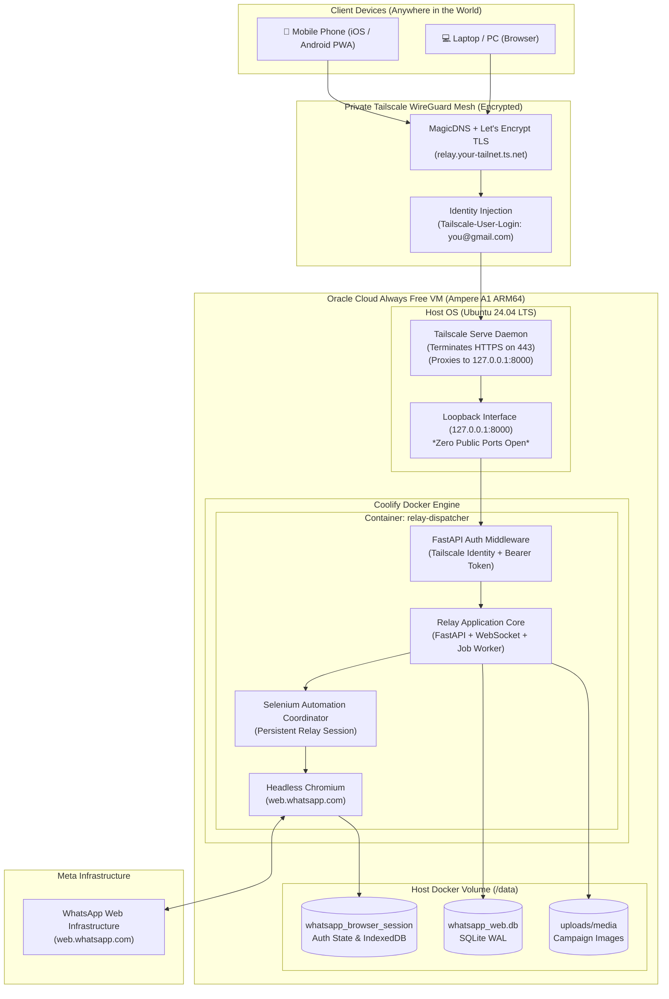

# Relay Cloud Edition &mdash; System Architecture & Security Model

## 1. Executive Summary

Relay Cloud Edition allows Relay v2.0 to run as a **private, 24/7 background messaging service** on a cloud virtual machine. The dashboard is accessible securely from any mobile phone, tablet, or PC worldwide via **Tailscale Private WireGuard Mesh**, without requiring a purchased domain, public IP exposure, or Cloudflare.

The existing Windows desktop application, installer, and dispatch engine remain 100% functional and intact.

---

## 2. Architectural Diagram

---

## 3. Defense-in-Depth Security Model

### Zero Public Ingress
- The Relay FastAPI application binds to `127.0.0.1:8000` on the host.
- The Oracle Cloud Virtual Cloud Network (VCN) and host firewall (`ufw`) do **not** open port 8000 or port 80/443 to the public internet (`0.0.0.0/0`).
- No attacker scanning the public IPv4 address of the Oracle Cloud server can detect or connect to Relay.

### Private WireGuard Mesh (Tailscale Serve)
- Access is restricted exclusively to authenticated devices inside your private Tailscale network ("tailnet").
- Tailscale automatically generates and renews a trusted Let's Encrypt TLS certificate for your unique MagicDNS name (`https://relay.<tailnet-name>.ts.net`).
- **No Tailscale Funnel is used.** Tailscale Funnel publishes services to the public internet; Tailscale Serve keeps traffic strictly within your private tailnet.

### Identity Header Authentication
- When requests pass through `tailscale serve`, Tailscale automatically appends tamper-proof identity headers:
  - `Tailscale-User-Login`: e.g. `yourname@gmail.com`
  - `Tailscale-User-Name`: e.g. `Your Name`
- Relay's `AuthMiddleware` verifies these headers. If `ALLOWED_TAILSCALE_USERS` is configured in `.env`, only specified email addresses are granted access; all others receive HTTP 403 Forbidden.

### App-Level Password / Token Fallback
- An optional `RELAY_AUTH_KEY` / `RELAY_PASSWORD` provides defense-in-depth and support for direct API token authentication or testing.

---

## 4. Single-Phone Pairing Workflow

Traditional WhatsApp automation requires pointing your phone camera at a computer screen displaying a QR code. When accessing Relay exclusively from your mobile phone, scanning a QR code on the same screen is impossible.

Relay Cloud solves this via WhatsApp Web's official **Link with Phone Number** protocol:

1. User opens Relay dashboard on their phone via Tailscale HTTPS.
2. User taps **Link with Phone Number** and inputs their mobile phone number.
3. Relay opens WhatsApp Web inside headless Chromium in the cloud, clicks "Link with phone number", and extracts the generated 8-character pairing code (e.g. `K9W3-7H2R`).
4. Relay displays the code prominently on the mobile screen with a 1-tap **Copy Code** button and a 120-second countdown.
5. User switches to their WhatsApp mobile app &rarr; **Settings** &rarr; **Linked Devices** &rarr; **Link a Device** &rarr; **Link with phone number instead** &rarr; enters the 8-character code.
6. WhatsApp Web in the cloud completes authentication, stores the session in persistent storage (`/data/whatsapp_browser_session`), and loads the dashboard.

---

## 5. Storage Persistence Across Restarts & Redeploys

All state is preserved across container rebuilds, Coolify redeploys, and VM reboots via the `/data` volume:

| Path in Container | Description | Persistence Strategy |
|---|---|---|
| `/data/whatsapp_web.db` | SQLite database (contacts, templates, campaigns, jobs, audit logs) | Mounted from host volume `relay_data` |
| `/data/whatsapp_browser_session/` | Chromium User Data directory (WhatsApp Web authentication tokens, LocalStorage, IndexedDB) | Preserved across restarts; no QR re-scan needed |
| `/data/uploads/media/` | User-uploaded images and documents | Preserved across restarts |
| `/data/config.json` | Application configuration and user preferences | Preserved across restarts |
