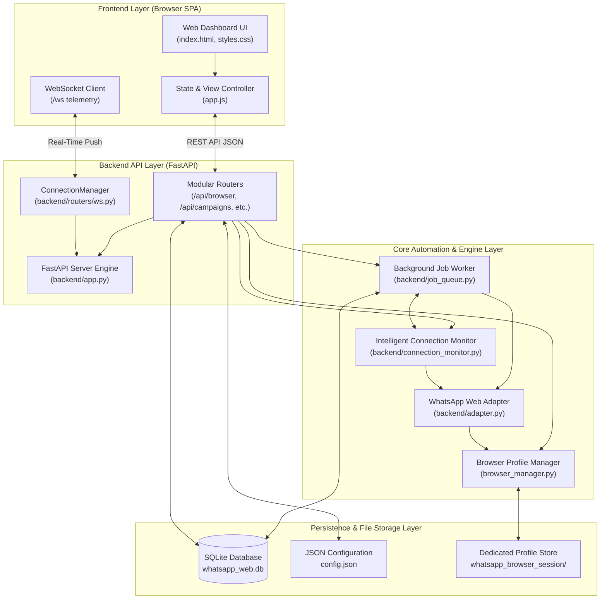
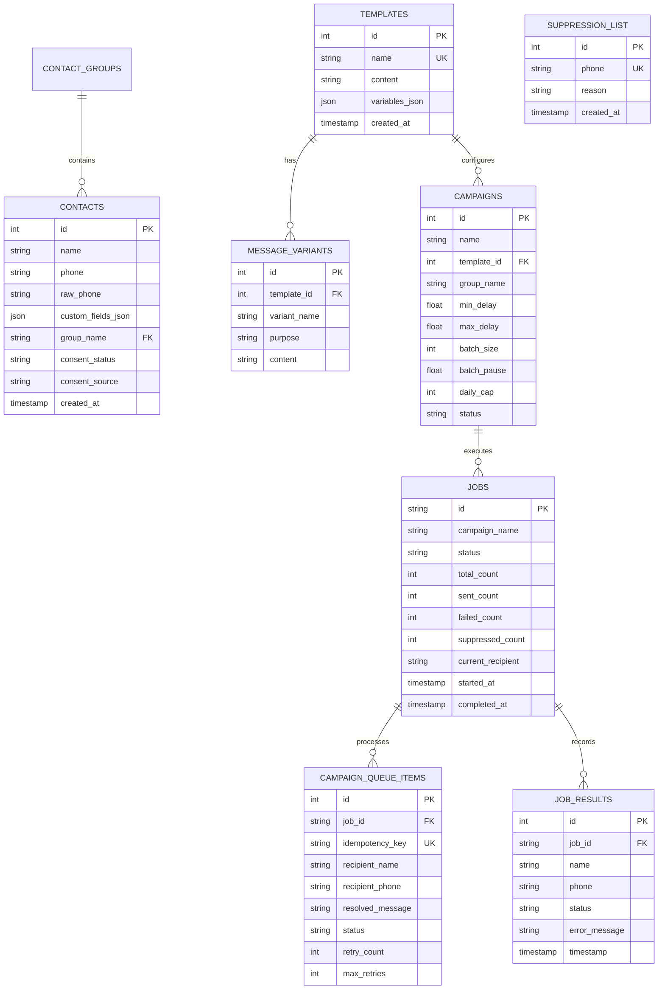
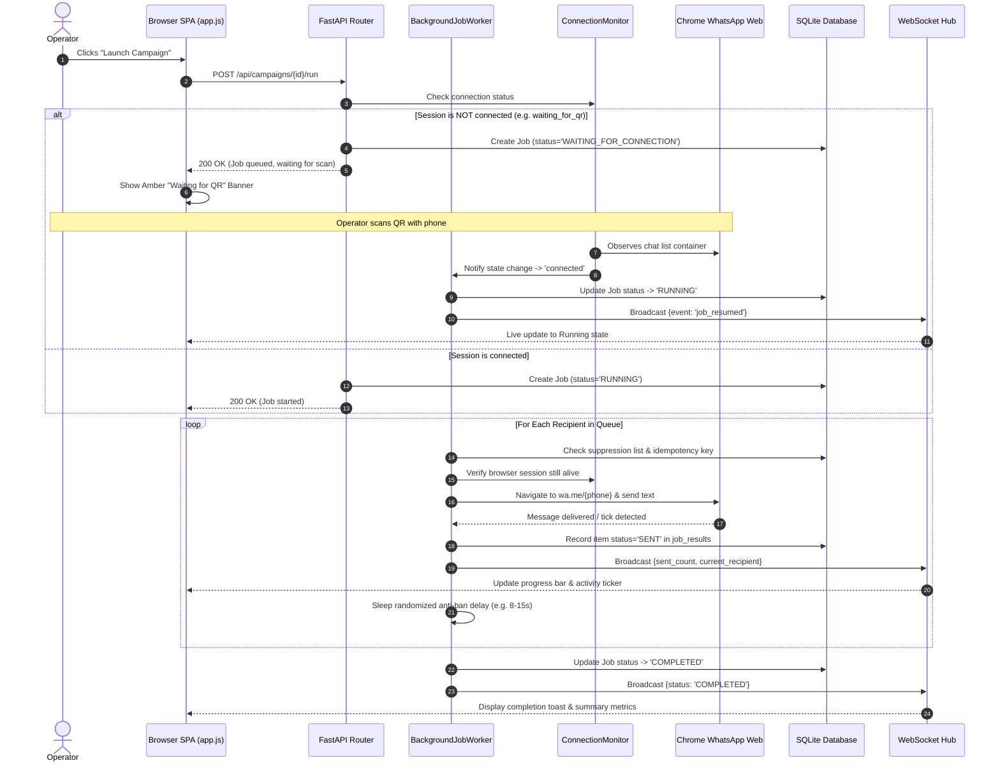

# 01 — System Architecture & Data Flow

## 1. Architectural Blueprint

The WhatsApp Automation Relay is engineered as a decoupled, multi-layer service. It pairs an asynchronous Python **FastAPI** backend with a lightweight, accessible **Single-Page Application (SPA)** and a thread-safe **Selenium WebDriver Automation Engine**.



---

## 2. Component & Directory Hierarchy

```
whatsapp automation/
├── backend/                        # Backend Application Package
│   ├── app.py                      # FastAPI initialization, static mount, lifespan, exception hooks
│   ├── database.py                 # SQLite database layer, schemas, indexes, and migrations
│   ├── connection_monitor.py       # 10-state lifecycle observer and state machine
│   ├── job_queue.py                # Background campaign queue worker, retries, and rate limiting
│   ├── models.py                   # Pydantic schemas for request/response validation
│   ├── adapter.py                  # Messaging provider abstraction (WhatsApp Web vs Mock)
│   ├── routers/                    # Modular API route controllers
│   │   ├── browser.py              # Profile scanning, locking checks, session launches
│   │   ├── campaigns.py            # Campaign CRUD, queue dispatching, and pre-flight checks
│   │   ├── contacts.py             # Contact import/export, grouping, and consent tracking
│   │   ├── templates.py            # Template CRUD, variable extraction, and dynamic previews
│   │   ├── jobs.py                 # Job inspection, pause, resume, cancel, drawer modal details
│   │   ├── logs.py                 # Activity event querying and KPI aggregations
│   │   ├── config.py               # Application configuration and safety limits
│   │   ├── media.py                # Media asset upload and mime-type validation
│   │   └── ws.py                   # WebSocket connection pool and telemetry broadcaster
│   └── static/                     # Frontend Client Bundle
│       ├── index.html              # Semantic HTML5 dashboard, forms, and modal drawers
│       ├── styles.css              # Design tokens, Light & Void themes, accessible radio cards
│       └── app.js                  # Vanilla JS SPA controller, reactive bindings, and toast notifications
├── browser_manager.py              # Local browser profile detection (Chrome, Edge, Brave, Firefox)
├── config_manager.py               # Atomic JSON configuration reader/writer
├── logger.py                       # Structured rotating logger with phone number masking
├── whatsapp_engine.py              # Low-level Selenium WhatsApp Web automation driver
├── start_dashboard.bat             # One-click Windows startup script
└── tests/                          # Automated Pytest Suite (49 tests)
    ├── test_api.py                 # REST endpoint integration tests
    └── test_connection_monitoring.py # Connection state machine and queue recovery tests
```

---

## 3. Database Schema Design (`whatsapp_web.db`)

All data is stored locally in SQLite with full foreign keys, write-ahead logging (WAL), and optimized indexes.



### Table Definitions & Purpose
1. **`contacts` & `contact_groups`**: Stores audience records with phone normalization (E.164 compliance), arbitrary custom field JSON payloads, and consent audit trails (`opted_in`, `opted_out`).
2. **`suppression_list`**: Global DNC (Do Not Call / Opt-Out) blacklist. Checked deterministically before any message dispatch.
3. **`templates` & `message_variants`**: Reusable message blueprints with template variables (`{{name}}`, `{{company}}`) and purpose-driven A/B/C variants.
4. **`campaigns`**: Configuration recipes specifying pace delays, batch sizes, audience filters, and attachments.
5. **`jobs`**: Historical and active execution instances tracking progress counters, timestamps, and execution states.
6. **`campaign_queue_items`**: Durable item queue with unique SHA-256 idempotency keys. Protects against duplicate deliveries during connection interruption.
7. **`job_results`**: Immutable delivery audit trail with error codes, timestamps, and message payloads.
8. **`logs`**: Structured application event logs for KPI calculation and audit investigations.

---

## 4. End-to-End Data & Execution Flow



