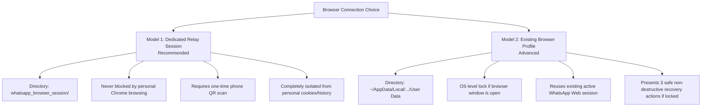

# 02 — Browser Automation Subsystem & Profile Management

## 1. Browser Discovery & Profile Scanning

The browser subsystem ([`browser_manager.py`](file:///c:/Users/Rift/Documents/Antigravity%20ide/whatsapp%20automation/browser_manager.py)) automatically detects installed browsers and extracts their user profile trees across Windows environments.

### Supported Browser Matrix

| Browser | Registry Key / App Paths | Default Executable Search Path | User Data Root Directory | Driver Engine |
| :--- | :--- | :--- | :--- | :--- |
| **Google Chrome** | `HKLM\...\chrome.exe` | `%ProgramFiles%\Google\Chrome\Application\chrome.exe` | `%LOCALAPPDATA%\Google\Chrome\User Data` | Selenium ChromeDriver |
| **Microsoft Edge** | `HKLM\...\msedge.exe` | `%ProgramFiles(x86)%\Microsoft\Edge\Application\msedge.exe` | `%LOCALAPPDATA%\Microsoft\Edge\User Data` | Selenium EdgeDriver |
| **Brave Browser** | `HKLM\...\brave.exe` | `%ProgramFiles%\BraveSoftware\Brave-Browser\Application\brave.exe` | `%LOCALAPPDATA%\BraveSoftware\Brave-Browser\User Data` | Selenium ChromeDriver (custom binary) |
| **Mozilla Firefox** | `HKLM\...\firefox.exe` | `%ProgramFiles%\Mozilla Firefox\firefox.exe` | `%APPDATA%\Mozilla\Firefox` | Selenium GeckoDriver |

### Profile Metadata Extraction
- **Chromium Browsers (Chrome, Edge, Brave):** Reads and parses `Local State` (JSON) located in the browser root. It traverses `profile.info_cache` to resolve human-readable profile names (e.g., `"Work Account"`, `"Personal"`), profile pictures, and folder identifiers (`"Default"`, `"Profile 1"`, `"Profile 2"`).
- **Mozilla Firefox:** Reads and parses `profiles.ini` (INI configuration) using `configparser`, resolving profile relative paths, default profile designations, and names.

---

## 2. The Two-Model Connection Architecture

To balance operator convenience against system reliability, the application implements two distinct operating models:



### Comparative Analysis

| Feature / Behavior | Dedicated Relay Session (Recommended) | Existing Browser Profile |
| :--- | :--- | :--- |
| **Directory Target** | Local app-managed directory: `whatsapp_browser_session/` | Host browser directory: `%LOCALAPPDATA%\Google\Chrome\User Data` |
| **Personal Window Conflict** | **Zero.** The user can browse freely in personal Chrome while Relay runs in parallel. | **High.** Chromium enforces single-process exclusive locks on the user profile directory. |
| **Initial Authentication** | Requires a one-time QR scan when launched. Session persists across app restarts. | Reuses existing WhatsApp Web session without re-scanning QR code. |
| **Data Protection & Privacy** | Isolated sandbox containing only WhatsApp Web session data. | Strictly read-only driver access; zero credential or cookie extraction. |
| **Default Setting** | Default out-of-the-box mode. | Optional advanced setting via Profile Picker Modal. |

---

## 3. Profile Lock Detection & Safe Recovery Mechanics

### Technical Anatomy of Chromium Locks
When Google Chrome or Microsoft Edge launches, Chromium acquires an exclusive OS-level file handle on:
`User Data\lockfile` (Windows) and spawns an ephemeral loopback socket written to `User Data\DevToolsActivePort`.

If another program (such as Selenium ChromeDriver) attempts to initialize using `--user-data-dir="User Data"`, Chromium detects the active lock and terminates with an immediate exit code (`DevToolsActivePort file doesn't exist`).

### Non-Destructive Availability Probing
Instead of attempting to launch a driver and catching crash stacktraces, [`browser_manager.py`](file:///c:/Users/Rift/Documents/Antigravity%20ide/whatsapp%20automation/browser_manager.py#L106-L126) probes the lock safely:

```python
@classmethod
def check_profile_availability(cls, browser_key: str, profile_path: str, is_dedicated: bool = False) -> str:
    lock_path = os.path.join(profile_path, "lockfile")
    if os.path.exists(lock_path):
        try:
            # Attempt to open with read/write access non-destructively
            with open(lock_path, "r+"):
                pass
            return "available"
        except (PermissionError, OSError):
            return "in_use"
    return "available"
```

### The 3 Inline Recovery Actions
When an existing profile is detected as `"in_use"`, the UI displays a clear inline warning banner:

> **Profile is currently open in Chrome**  
> *Close Chrome completely to use this profile for automated messaging, or use a dedicated Relay session instead.*

The system exposes exactly three deterministic recovery choices:
1. **Use dedicated session (Recommended)**:
   - Calls `POST /api/browser-profile/dedicated`.
   - Switches the active profile target to `__dedicated__` immediately.
   - Preserves personal browser windows without interruption.
2. **Choose another profile**:
   - Opens the Profile Picker Modal (`#modal-profile-picker`), allowing the operator to select another installed browser (e.g. Edge, Brave) or a different unused profile.
3. **I closed Chrome — try again**:
   - Calls `POST /api/browser-profile/test`.
   - Re-probes `lockfile` availability. If the user closed Chrome, updates status to `available` and initializes the connection.

> [!IMPORTANT]
> The application **never** attempts to kill Chrome processes forcefully (`taskkill`), never alters Chrome's SQLite databases, and never copies session cookies from active personal windows.

---

## 4. Driver Initialization & Anti-Detection Flags

Chromium is launched with a specialized options profile configured in [`browser_manager.py`](file:///c:/Users/Rift/Documents/Antigravity%20ide/whatsapp%20automation/browser_manager.py#L290-L360):

```python
options = ChromeOptions()
options.add_argument(f"--user-data-dir={user_data_path}")
if profile_dir and profile_dir != "__dedicated__":
    options.add_argument(f"--profile-directory={profile_dir}")

# Anti-Detection & Stability Switches
options.add_argument("--disable-blink-features=AutomationControlled")
options.add_experimental_option("excludeSwitches", ["enable-automation"])
options.add_experimental_option("useAutomationExtension", False)
options.add_argument("--no-first-run")
options.add_argument("--no-default-browser-check")
options.add_argument("--start-maximized")
```

Additionally, Chrome DevTools Protocol (CDP) scripts are injected upon page load to overwrite `navigator.webdriver = false`, preventing WhatsApp Web from flagging the automation session.

