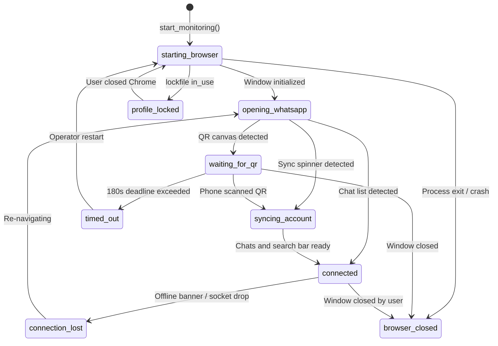

# 03 — Connection Monitoring Engine & Lifecycle State Machine

## 1. Problem Diagnosis & Architectural Evolution

Prior to this implementation, WhatsApp Web session status checks suffered from three failure modes:
1. **Passive Driver Launch Without URL Navigation**: `open_browser_profile` initialized a browser window but did not immediately navigate to `https://web.whatsapp.com`, leaving the window at a blank tab.
2. **Dual-Driver Lock Contention**: The "Test Connection" button spawned an ephemeral headless Chrome session targeting the same user directory as an already-open window, triggering `DevToolsActivePort` socket crashes.
3. **One-Shot Timeout Without Observation**: The frontend relied on a static single timer (`setTimeout(..., 2500)`). If the user had not yet scanned the QR code with their mobile phone, the UI permanently froze in "Opening..." or "Needs QR sign-in" without ever detecting when authentication completed.

To solve this permanently, we built [`backend/connection_monitor.py`](file:///c:/Users/Rift/Documents/Antigravity%20ide/whatsapp%20automation/backend/connection_monitor.py), a thread-safe singleton observer running a non-blocking background observation loop.

---

## 2. The 10-State Lifecycle Engine

The connection monitor implements a formal state machine with 10 deterministic states:



### Complete State Specification

| State Identifier | Human Label | Badge Variant | Stepper Stage | Current Activity Ticker | Primary Dynamic Actions |
| :--- | :--- | :--- | :--- | :--- | :--- |
| `starting_browser` | "Starting browser" | Amber Pulse | Browser launched | "Launching browser window..." | `Cancel` |
| `opening_whatsapp` | "Opening WhatsApp Web" | Amber Pulse | WhatsApp opened | "Opening web.whatsapp.com..." | `Cancel` |
| `waiting_for_qr` | "Waiting for QR scan" | Amber Pulse | QR detected (active) | "Waiting for QR scan — checking again in 2s" | `Open WhatsApp Web`, `Cancel`, `Change profile` |
| `syncing_account` | "Syncing account" | Blue Pulse | Login confirmed | "Syncing chats and messages..." | `Refresh status` |
| `connected` | "Connected" | Emerald Solid | Connection ready | "WhatsApp Web connected and ready" | `Open session`, `Refresh status`, `Change profile` |
| `profile_locked` | "Profile locked" | Coral Red | Browser launched (halted) | "Profile open in Chrome window" | `Try again`, `Use dedicated session`, `Change profile` |
| `browser_closed` | "Browser closed" | Neutral Dark | Step 1 (pending) | "Browser window was closed" | `Restart connection`, `View details`, `Change profile` |
| `connection_lost` | "Connection lost" | Coral Red | WhatsApp opened (halted) | "Connection dropped — reconnecting..." | `Restart connection`, `Change profile` |
| `timed_out` | "Timed out" | Amber Solid | Step 3 (timed out) | "Scan timed out after 180s" | `Refresh status`, `Restart connection` |
| `unknown_error` | "Unknown error" | Coral Red | Step 1 (error) | "Browser crashed or exited" | `Restart connection`, `Change profile` |

---

## 3. DOM Probing Heuristics & Selectors

The background observation thread runs every **1.8 seconds** and inspects DOM container elements non-destructively:

### 1. Connected / Authenticated Indicators
```python
# Primary indicators: presence of chat list pane or active message search
chat_selectors = [
    (By.CSS_SELECTOR, "div#pane-side"),
    (By.CSS_SELECTOR, "div[role='textbox']"),
    (By.CSS_SELECTOR, "header[data-testid='chatlist-header']"),
    (By.XPATH, "//div[@contenteditable='true']")
]
```

### 2. Account Syncing & Loading Indicators
```python
sync_selectors = [
    (By.CSS_SELECTOR, "div[data-animate-progress]"),
    (By.CSS_SELECTOR, "progress"),
    (By.XPATH, "//div[contains(text(), 'Downloading messages')]"),
    (By.XPATH, "//div[contains(text(), 'Starting chat')]"),
    (By.XPATH, "//div[contains(text(), 'Loading your chats')]")
]
```

### 3. QR Code Presence Indicators
```python
qr_selectors = [
    (By.CSS_SELECTOR, "canvas[aria-label*='Scan']"),
    (By.CSS_SELECTOR, "canvas"),
    (By.CSS_SELECTOR, "div[data-ref]")
]
```

### 4. Offline / Connection Lost Indicators
```python
offline_selectors = [
    (By.CSS_SELECTOR, "div[data-testid='banner-offline']"),
    (By.XPATH, "//span[contains(text(), 'Computer not connected')]"),
    (By.XPATH, "//span[contains(text(), 'Phone not connected')]")
]
```

> [!NOTE]
> **Zero Credential Scraping:** The monitor checks element existence only via `is_displayed()`. It **never** reads, logs, or transmits QR code bit patterns, session tokens, local storage values, phone numbers, or chat text.

---

## 4. Visual 5-Step Timeline Stepper

The UI renders the connection progression through an accessible 5-step stepper:

```
[1. Browser launched] ──> [2. WhatsApp opened] ──> [3. QR detected] ──> [4. Login confirmed] ──> [5. Connection ready]
       ✓ 17:28:02                ✓ 17:28:05             ✓ 17:28:09            ✓ 17:28:18               ✓ 17:28:20
```

Each step transitions dynamically between `pending` (empty ring), `active` (pulsing blue/amber ring), and `completed` (green checkmark with timestamp) based on live backend telemetry.

---

## 5. Event Publishing & Job Queue Coupling

`ConnectionMonitor` maintains an observer registry. When the state changes:
1. **WebSocket Broadcast**: Pushes a JSON snapshot immediately to all connected clients on `/ws`.
2. **BackgroundJobWorker Notification**:
   - If a campaign is currently queued in `WAITING_FOR_CONNECTION` and state transitions to `connected`, the worker **automatically resumes execution**.
   - If an active campaign encounters `connection_lost` or `browser_closed`, the worker **immediately pauses execution** to prevent dropped messages or false failure reports.

