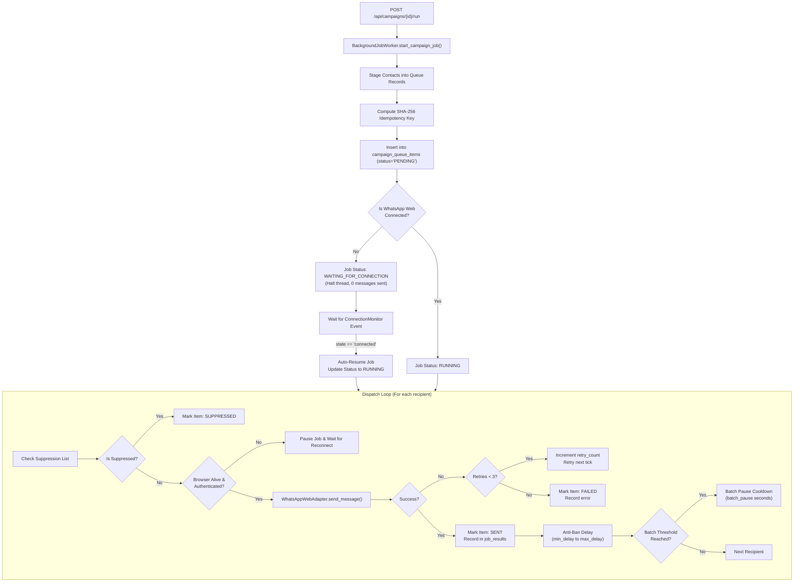

# 04 — Campaign Queue & Execution Subsystem

## 1. Subsystem Architecture

The campaign dispatching engine is managed by [`BackgroundJobWorker`](file:///c:/Users/Rift/Documents/Antigravity%20ide/whatsapp%20automation/backend/job_queue.py), a thread-safe execution controller backed by durable SQLite tables.



---

## 2. Pre-Flight Connection Gating & Auto-Resume

### The Problem It Solves
Previously, if an operator clicked "Launch Campaign" while the browser was waiting for a QR scan, the engine would attempt to navigate immediately, leading to socket timeout errors, unhandled exceptions, and burned contacts falsely marked as failed.

### The Implementation
1. **Pre-Flight Inspection**: Prior to starting worker threads, `BackgroundJobWorker` invokes:
   ```python
   is_connected = connection_monitor.is_connected()
   initial_status = "RUNNING" if is_connected else "WAITING_FOR_CONNECTION"
   ```
2. **Deterministic Waiting State**:
   - If not connected, the job is saved with status `WAITING_FOR_CONNECTION`.
   - All contacts in `campaign_queue_items` remain strictly in `PENDING` state.
   - Zero network packets are sent to WhatsApp Web.
   - The UI displays an amber notification banner: *"Waiting for WhatsApp Web connection before starting dispatch..."*.
3. **Autonomous Resume**:
   - `BackgroundJobWorker` registers a listener callback with `ConnectionMonitor`:
     ```python
     def _on_connection_change(self, state: str, snapshot: Dict[str, Any]):
         if state == "connected" and cur_status == "WAITING_FOR_CONNECTION":
             self._active_job["status"] = "RUNNING"
             db.update_job_status(job_id, "RUNNING")
             self.resume_job()
     ```
   - As soon as the operator scans the QR code with their mobile device, the observer detects the chat list, fires the event, and the queue **automatically starts sending without requiring manual button clicks**.

---

## 3. Idempotency Hashing & Duplicate Prevention

To ensure that campaigns can be paused, resumed, or recovered across application crashes without sending duplicate messages to customers, every queue entry is stamped with an **idempotency hash**:

```python
idempotency_key = hashlib.sha256(
    f"{actual_job_id}:{phone}:{resolved_message}".encode("utf-8")
).hexdigest()
```

- Enforced by a `UNIQUE` index on `campaign_queue_items.idempotency_key`.
- When resuming a job, the query selects only records where:
  `WHERE job_id = ? AND status = 'PENDING' ORDER BY id ASC`.
- Messages previously completed with `status = 'SENT'` are **never** re-evaluated or re-sent.

---

## 4. Anti-Ban Humanization & Rate Pacing

WhatsApp enforces automated rate-limiting algorithms. To protect user numbers from temporary bans or account flags, the execution engine enforces multi-layered humanization:

### 1. Pacing Presets

| Pace Option | Delay Range per Message | Recommended Use Case |
| :--- | :--- | :--- |
| **Normal (Default)** | 8.0s – 15.0s randomized delay | Standard transactional notifications, order updates |
| **Relaxed (Safe)** | 12.0s – 20.0s randomized delay | New accounts, promotional updates, cold outreach |
| **Fast** | 4.0s – 8.0s randomized delay | High-volume operational alerts to pre-saved contacts |

### 2. Batching Cooldowns
- **Batch Size:** Groups recipients into chunks (e.g. 20 messages).
- **Batch Pause:** Pauses dispatch for 60 to 120 seconds after each chunk, mimicking human conversational pauses.
- **Daily Cap:** Hard ceiling (`daily_cap`, default 100) preventing accidental batch over-sends.

### 3. Keystroke Emulation
The Selenium adapter ([`backend/adapter.py`](file:///c:/Users/Rift/Documents/Antigravity%20ide/whatsapp%20automation/backend/adapter.py)) simulates organic human typing by emitting characters with randomized micro-delays (25ms to 75ms per keystroke) rather than instant clipboard pasting.

---

## 5. Live Recipient Queue Inspection Drawer

In the **Activity** tab, clicking on any active or completed job opens the **Recipient Queue Inspector Drawer** (`#modal-job-drawer`):

- **Live Dynamic Table**: Displays row-level delivery details:
  - Recipient Name and Masked Phone (`+1 415 ••• ••71` under Privacy Mode).
  - Selected Purpose-Driven Message Variant.
  - Delivery Status Pill (`SENT`, `PENDING`, `FAILED`, `SUPPRESSED`).
  - Retry counter (e.g. `1/3`).
  - Exact delivery timestamp or error diagnostic code.
- **Operator Controls**: Provides instant `Pause Campaign`, `Resume Campaign`, or `Cancel Campaign` buttons that safely adjust state in both memory and SQLite.

