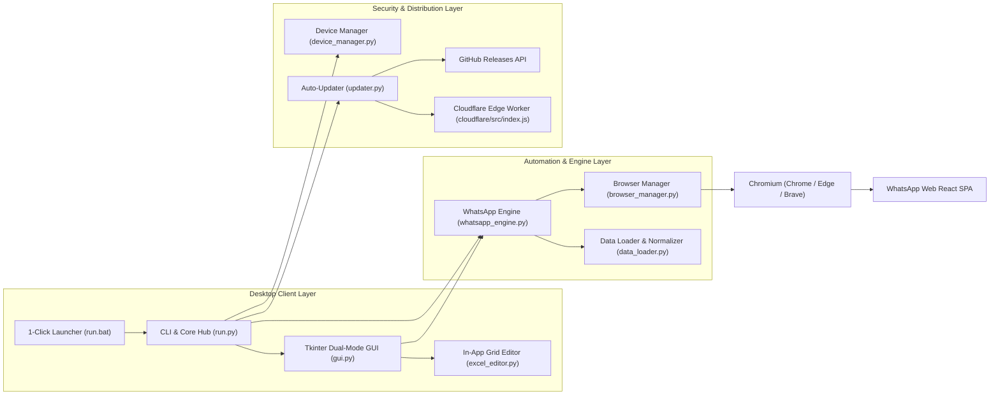
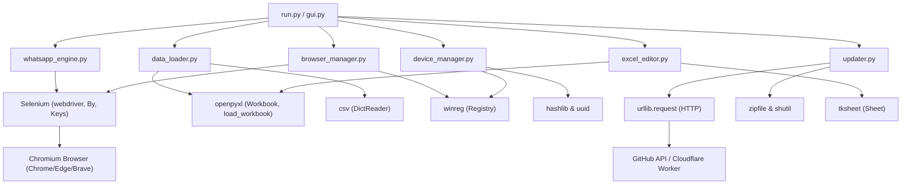
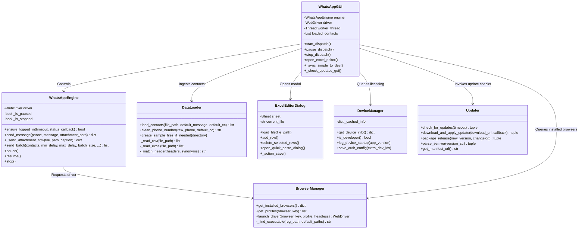
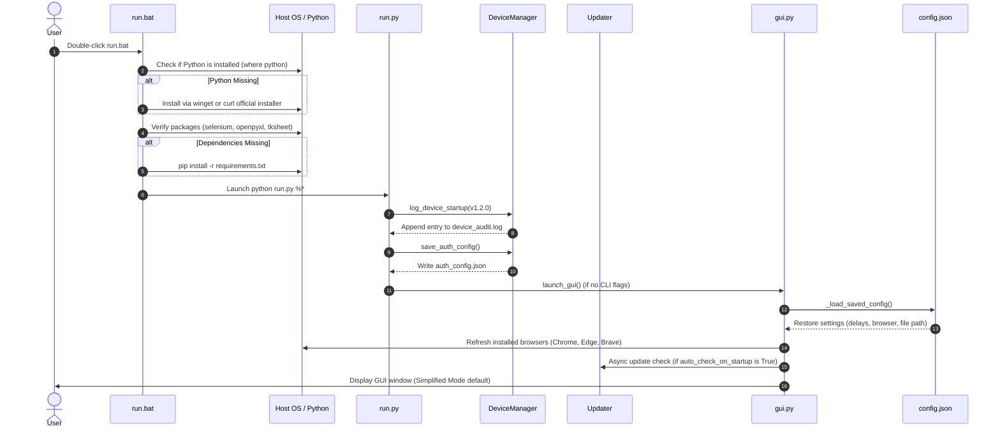
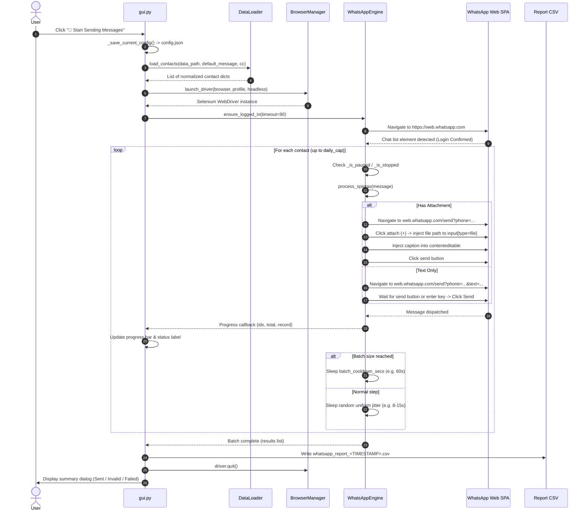
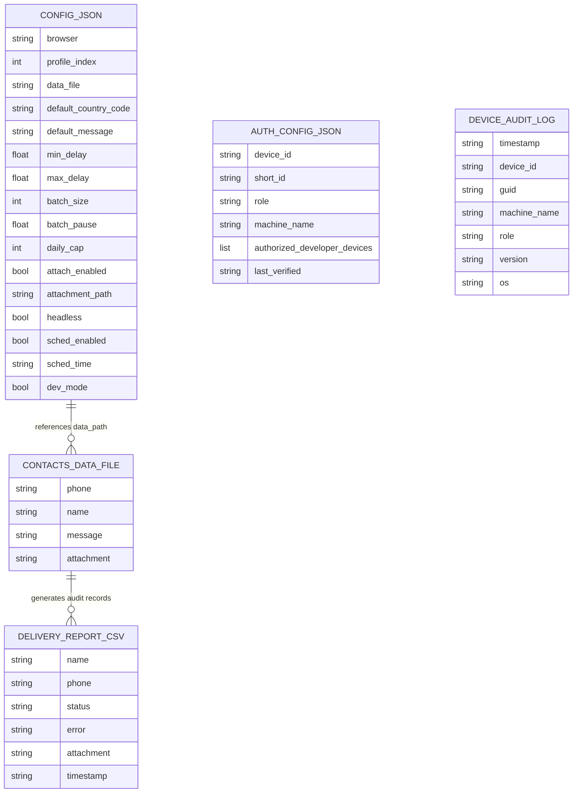
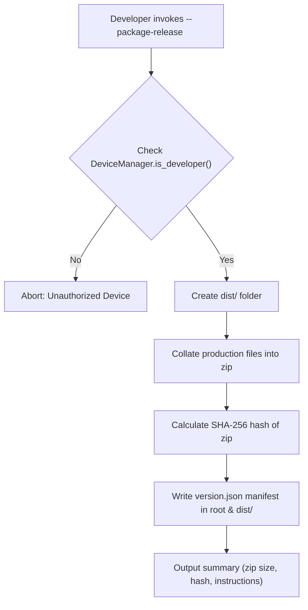

# WhatsApp Bulk Messenger Pro - Complete Technical Documentation

> **Project Name:** WhatsApp Bulk Messenger Pro  
> **Release Version:** 2.0.0 (Web Dashboard Edition)  
> **Repository Path:** `c:/Users/Rift/Documents/Antigravity ide/whatsapp automation`  
> **Target OS:** Windows 10 / Windows 11 (64-bit)  
> **Primary Runtime:** Python 3.10+ (Verified on Python 3.14.7; bootstrapped via [run.bat](file:///c:/Users/Rift/Documents/Antigravity%20ide/whatsapp%20automation/run.bat))  
> **Architecture:** Decoupled Local-First Web Application (FastAPI ASGI Backend + Modern HTML5/Tailwind Reactive SPA)  
> **Date of Documentation:** November 2026  

---

## 1. Project Overview

[WhatsApp Bulk Messenger Pro](file:///c:/Users/Rift/Documents/Antigravity%20ide/whatsapp%20automation/README.md) is an enterprise-grade automation platform, REST API, real-time WebSocket telemetry engine, and modern web dashboard developed in Python and modern web technologies for dispatching personalized bulk WhatsApp messages, multimedia assets (images and videos), and PDF brochures directly through authenticated WhatsApp Web browser sessions.

Originally created as a desktop Python automation tool, Version 2.0.0 represents a complete architectural transformation:
1. **Modern Responsive Web Dashboard**: A single-page application served directly from FastAPI, providing overview KPIs, contact hub, template studio, guided campaign wizard, real-time job monitor, audit logs, and hardware telemetry.
2. **FastAPI ASGI Backend & WebSockets**: High-performance RESTful API with automated OpenAPI docs (`/api/docs`), Pydantic validation, and bidirectional WebSocket telemetry (`/ws`).
3. **Resilient Local Persistence**: Embedded SQLite storage (`whatsapp_web.db`) for contacts, audience groups, reusable templates, approved media assets, purpose-driven message variants, global suppression lists, and durable per-recipient queue items with SHA-256 idempotency keys.
4. **Decoupled Messaging Provider Architecture**: Automation logic abstracted behind a `MessagingProvider` interface, supporting both real `WhatsAppWebAdapter` (Selenium automation) and `MockMessagingProvider` for instantaneous testing.
5. **Anti-Ban Protection & Legitimate Purpose-Driven Variants**: Uniform delay jitter, automated batch cooldown pauses, daily message volume limits, named safety presets (Safe Warm-up, Balanced, Fast Alerts), and legitimate purpose-driven message variants (language localization, customer tiers, approved creative testing) with explicit recipient eligibility rules.
6. **Enterprise Opt-In & Compliance Safeguards**: Mandatory opt-in consent metadata recording (`consent_status`, `consent_source`), global suppression/opt-out list enforcement, and automatic pre-queue filtering.
7. **Interactive Smartphone Conversation Composer**: Real-time phone preview featuring realistic chat bubbles, approved media attachment rendering, and a recipient persona variable switcher explaining exact variant eligibility.
8. **5-Stage Guided Campaign Staging Wizard**: Audience & Consent -> Content & Variants -> Pacing & Safety -> Pre-Flight Review & Dry-Run -> Launch & Live Telemetry.
9. **Durable Queue Execution & Retry Policies**: Bounded exponential backoff with jitter on transient DOM/network timeouts, instant fail-fast on permanent errors (`INVALID_PHONE`, `UNREGISTERED_USER`, `SUPPRESSED`), and queue idempotency protection.
10. **Comprehensive Automated Test Suite**: 66 passing automated tests in `tests/` covering unit logic, validation, presets, consent updates, suppression lists, media assets, message variants, queue idempotency, and API endpoints with 100% pass rate.

The repository originated as a fork of an open-source project by Ramesh Kumar (`@inforkgodara`), titled `python-automated-bulk-whatsapp-messages` (dating to circa 2020). The upstream repository was a minimal 53-line script ([script.py](file:///c:/Users/Rift/Documents/Antigravity%20ide/whatsapp%20automation/script.py)) accompanied by a legacy Selenium 3 executable ([chromedriver.exe](file:///c:/Users/Rift/Documents/Antigravity%20ide/whatsapp%20automation/chromedriver.exe)) and a sample spreadsheet ([Customer bulk email data.xlsx](file:///c:/Users/Rift/Documents/Antigravity%20ide/whatsapp%20automation/Customer%20bulk%20email%20data.xlsx)). That baseline was non-functional on modern WhatsApp Web due to deprecated Selenium syntax, obsolete browser drivers, broken DOM query selectors, lack of media attachment handling, and missing anti-ban defenses.

The modern codebase transforms that legacy prototype into a production desktop application featuring:
1. **Dual-Mode Desktop Interface**: A streamlined 3-step dashboard for non-technical users, alongside an advanced 6-tab Developer Mode.
2. **Built-in Spreadsheet Grid Editor**: In-app editing, row management, and quick-pasting of phone numbers powered by [`tksheet`](file:///c:/Users/Rift/Documents/Antigravity%20ide/whatsapp%20automation/excel_editor.py) without requiring Microsoft Excel.
3. **Anti-Ban Protection Engine**: Uniform delay jitter, automated batch cooldown pauses, daily message volume limits, and a recursive Spintax variation engine (`{Hi|Hello|Hey}`) designed to defeat spam hash fingerprinting.
4. **Hardware Device Licensing & Audit Trails**: Windows registry-based machine identification, developer whitelisting, and local audit logging.
5. **Edge-Distributed Auto-Updater**: Remote version checks, safe selective file patching, developer 1-click release packaging, and optional Cloudflare Workers edge distribution.



---

## 2. Purpose and Intended Use

### 2.1 The Core Problem
Organizations, educational institutions, real estate agencies, and retailers frequently require direct communication with customers, staff, or student bodies. The official **WhatsApp Business Platform (Cloud API)** introduces significant barriers for small-to-medium enterprises:
- Per-conversation messaging tariffs (categorized under Marketing, Utility, Authentication, and Service rates).
- Mandatory pre-approval for message templates.
- Strict 24-hour customer service session windows.
- Complex developer verification and Meta Business Manager account onboarding.

Conversely, manual dispatch through WhatsApp Web is error-prone and time-consuming, while naive automation scripts trigger rapid account bans because WhatsApp's spam-detection infrastructure actively identifies:
1. Fixed, non-varying time intervals between consecutive dispatches (velocity profiling).
2. Repetitive identical message strings sent to multiple un-saved numbers (hash fingerprinting).
3. Bursts of high-volume messages dispatched without idle cooldown intervals.
4. Heavy recipient report/block ratios resulting from unformatted, impersonal text.

### 2.2 Target Personas and Use Cases
The application is engineered to serve two distinct user profiles:

| User Persona | Preferred Interface | Typical Workflow |
| :--- | :--- | :--- |
| **Business Operators & Marketers** | Simplified GUI Mode | Loads a `.xlsx` or `.csv` contact list, inputs message copy, attaches a promotional flyer or PDF invoice, and clicks **Start Sending**. |
| **System Integrators & Developers** | Developer Mode / Headless CLI | Tunes anti-ban delay sliders, selects isolated browser profiles, schedules recurring dispatches via `--schedule HH:MM`, monitors hardware audits, and packages new releases. |

#### Validated Use Cases
- **Transactional Notifications**: Sending order confirmations, payment receipts, appointment reminders, and service alerts to existing customers.
- **Personalized Marketing**: Dispatching promotional flyers, seasonal discounts, or event invitations with individualized greetings (`{first_name}`) and Spintax variation.
- **Internal Operations**: Automated delivery of shift rosters, meeting agendas, and internal notices to employee lists.

#### Prohibited / High-Risk Use Cases
- Unsolicited cold-calling or mass spam campaigns to scraped, un-consented numbers.
- High-velocity dispatch exceeding 250 messages per day on un-warmed or brand-new SIM cards.
- Bypassing two-factor authentication or attempting unauthorized scraping of private chat histories.

---

## 3. Feature Inventory

The following table provides an exhaustive technical inventory of every user-facing and architectural feature implemented across the repository:

| Feature Name | Primary Module / Symbol | Invocation Method | Inputs | Outputs / Side Effects |
| :--- | :--- | :--- | :--- | :--- |
| **Simplified 3-Step GUI** | [`gui.py`](file:///c:/Users/Rift/Documents/Antigravity%20ide/whatsapp%20automation/gui.py) (`_build_simple_ui`) | Launch app without flags (Default view) | User clicks, file selections, text inputs | Simplified card layout; automatically syncs data model with Developer Mode |
| **Developer 6-Tab GUI** | [`gui.py`](file:///c:/Users/Rift/Documents/Antigravity%20ide/whatsapp%20automation/gui.py) (`_build_dev_ui`) | Toggle `🛠️ Developer Mode` checkbutton | Checkbox toggle event | Window expands from 780x680 to 980x740; displays advanced configuration tabs |
| **In-App Excel Grid Editor** | [`excel_editor.py`](file:///c:/Users/Rift/Documents/Antigravity%20ide/whatsapp%20automation/excel_editor.py) ([`ExcelEditorDialog`](file:///c:/Users/Rift/Documents/Antigravity%20ide/whatsapp%20automation/excel_editor.py#L22)) | Click `📊 Open Built-in Excel Editor` | `.xlsx`, `.xls`, `.csv` file path | Full `tksheet` editing grid; cell edits, row addition/deletion, direct file save |
| **Quick-Paste Number Importer** | [`excel_editor.py`](file:///c:/Users/Rift/Documents/Antigravity%20ide/whatsapp%20automation/excel_editor.py) (`open_quick_paste_dialog`) | Click `📋 Quick Paste Numbers` in editor | Raw multiline text containing phone numbers or `phone, name` | Regex parses and cleans digits, inserts rows directly into active grid |
| **Flexible Contact Loading** | [`data_loader.py`](file:///c:/Users/Rift/Documents/Antigravity%20ide/whatsapp%20automation/data_loader.py) ([`DataLoader.load_contacts`](file:///c:/Users/Rift/Documents/Antigravity%20ide/whatsapp%20automation/data_loader.py#L64)) | GUI load or CLI execution | File path, default message, default country code | Returns list of normalized contact dictionaries |
| **Phone Sanitization** | [`data_loader.py`](file:///c:/Users/Rift/Documents/Antigravity%20ide/whatsapp%20automation/data_loader.py) ([`DataLoader.clean_phone_number`](file:///c:/Users/Rift/Documents/Antigravity%20ide/whatsapp%20automation/data_loader.py#L158)) | Invoked during contact loading | Raw string (e.g. `+91 (987) 654-3210`) | Strips non-digits, prepends country code if 10 digits, validates length (10–16 digits) |
| **Message Templating** | [`data_loader.py`](file:///c:/Users/Rift/Documents/Antigravity%20ide/whatsapp%20automation/data_loader.py) ([`DataLoader.load_contacts`](file:///c:/Users/Rift/Documents/Antigravity%20ide/whatsapp%20automation/data_loader.py#L112-L121)) | Automatic during contact load | Contact row dict, message template string | Substitutes `{name}`, `{customer_name}`, `{first_name}`, `{phone}`, and arbitrary `{{{column}}}` |
| **Recursive Spintax Engine** | [`whatsapp_engine.py`](file:///c:/Users/Rift/Documents/Antigravity%20ide/whatsapp%20automation/whatsapp_engine.py) ([`process_spintax`](file:///c:/Users/Rift/Documents/Antigravity%20ide/whatsapp%20automation/whatsapp_engine.py#L24)) | Evaluated before each dispatch | Text with `{A|B|C}` notation | Substitutes random choices recursively; preserves non-spintax tags |
| **Direct Click-to-Chat URL** | [`whatsapp_engine.py`](file:///c:/Users/Rift/Documents/Antigravity%20ide/whatsapp%20automation/whatsapp_engine.py) ([`WhatsAppEngine.send_message`](file:///c:/Users/Rift/Documents/Antigravity%20ide/whatsapp%20automation/whatsapp_engine.py#L138)) | Automatic per contact | Target phone, URL-encoded text | Navigates directly to `web.whatsapp.com/send?phone=...`, works for unsaved contacts |
| **Media & Doc Attachment** | [`whatsapp_engine.py`](file:///c:/Users/Rift/Documents/Antigravity%20ide/whatsapp%20automation/whatsapp_engine.py) (`_send_attachment_flow`) | Specified via global or per-row attachment | File path, caption text | Automates file input, waits for preview overlay, injects caption, clicks send |
| **Invalid Number Detection** | [`whatsapp_engine.py`](file:///c:/Users/Rift/Documents/Antigravity%20ide/whatsapp%20automation/whatsapp_engine.py) (`_dismiss_invalid_popup`) | Triggered if WhatsApp modal appears | DOM invalid number warning | Dismisses modal dialog, flags contact as `INVALID_NUMBER` |
| **Anti-Ban Jitter & Cooldown** | [`whatsapp_engine.py`](file:///c:/Users/Rift/Documents/Antigravity%20ide/whatsapp%20automation/whatsapp_engine.py) ([`WhatsAppEngine.send_batch`](file:///c:/Users/Rift/Documents/Antigravity%20ide/whatsapp%20automation/whatsapp_engine.py#L320)) | Configurable in Cooldown Tab | Min delay, max delay, batch size, pause duration | Random uniform sleeps between messages; long breaks after batch limits |
| **Browser & Profile Detection** | [`browser_manager.py`](file:///c:/Users/Rift/Documents/Antigravity%20ide/whatsapp%20automation/browser_manager.py) ([`BrowserManager.get_profiles`](file:///c:/Users/Rift/Documents/Antigravity%20ide/whatsapp%20automation/browser_manager.py#L85)) | Startup & browser selection | Target browser (`chrome`, `edge`, `brave`) | Discovers profiles from `Local State` JSON; provisions dedicated isolated profile |
| **Hardware Fingerprinting** | [`device_manager.py`](file:///c:/Users/Rift/Documents/Antigravity%20ide/whatsapp%20automation/device_manager.py) ([`DeviceManager.get_device_info`](file:///c:/Users/Rift/Documents/Antigravity%20ide/whatsapp%20automation/device_manager.py#L32)) | Startup in GUI and CLI | Windows Registry `MachineGuid` + MAC node | Generates immutable `DEV-<HEX>` ID; assigns `DEVELOPER` or `CLIENT` role |
| **Startup Audit Logging** | [`device_manager.py`](file:///c:/Users/Rift/Documents/Antigravity%20ide/whatsapp%20automation/device_manager.py) ([`DeviceManager.log_device_startup`](file:///c:/Users/Rift/Documents/Antigravity%20ide/whatsapp%20automation/device_manager.py#L86)) | Every application execution | Current version, device info | Appends formatted audit trace to [device_audit.log](file:///c:/Users/Rift/Documents/Antigravity%20ide/whatsapp%20automation/device_audit.log) |
| **Recurring Daily Scheduler** | [`run.py`](file:///c:/Users/Rift/Documents/Antigravity%20ide/whatsapp%20automation/run.py) ([`run_scheduler_loop`](file:///c:/Users/Rift/Documents/Antigravity%20ide/whatsapp%20automation/run.py#L161)), [`gui.py`](file:///c:/Users/Rift/Documents/Antigravity%20ide/whatsapp%20automation/gui.py) (`_scheduler_worker`) | CLI `--schedule HH:MM` or GUI Scheduler Tab | Time string `HH:MM` | Runs continuous daemon loop; triggers automated dispatch when target time arrives |
| **Remote Auto-Updater** | [`updater.py`](file:///c:/Users/Rift/Documents/Antigravity%20ide/whatsapp%20automation/updater.py) ([`Updater.check_for_updates`](file:///c:/Users/Rift/Documents/Antigravity%20ide/whatsapp%20automation/updater.py#L111)) | Startup background thread, GUI button, CLI `--check-update` | Manifest URL (GitHub / Cloudflare) | Fetches manifest, compares semver, prompts user, downloads and extracts update zip |
| **Developer Release Packager** | [`updater.py`](file:///c:/Users/Rift/Documents/Antigravity%20ide/whatsapp%20automation/updater.py) ([`Updater.package_release`](file:///c:/Users/Rift/Documents/Antigravity%20ide/whatsapp%20automation/updater.py#L255)) | CLI `--package-release` or GUI Publishing tab | Target version string, changelog notes | Verifies developer role, builds sanitized zip in `dist/`, calculates SHA-256 |
| **Headless Execution** | [`run.py`](file:///c:/Users/Rift/Documents/Antigravity%20ide/whatsapp%20automation/run.py) (`--headless`), [`gui.py`](file:///c:/Users/Rift/Documents/Antigravity%20ide/whatsapp%20automation/gui.py) (`headless_var`) | CLI flag or GUI checkbox | Boolean flag | Appends `--headless=new` to Chromium options, running browser without UI window |
| **Delivery Reporting** | [`run.py`](file:///c:/Users/Rift/Documents/Antigravity%20ide/whatsapp%20automation/run.py) (`run_batch_job`), [`gui.py`](file:///c:/Users/Rift/Documents/Antigravity%20ide/whatsapp%20automation/gui.py) (`_dispatch_worker`) | End of batch execution | Batch results list | Exports CSV report `whatsapp_report_YYYYMMDD_HHMMSS.csv` with delivery status per row |
| **1-Click Windows Bootstrapper**| [`run.bat`](file:///c:/Users/Rift/Documents/Antigravity%20ide/whatsapp%20automation/run.bat) | Double-click `run.bat` | Windows host environment | Automatically installs Python (winget/curl), installs dependencies, runs app |
| **Cloudflare Edge Distribution**| [`cloudflare/src/index.js`](file:///c:/Users/Rift/Documents/Antigravity%20ide/whatsapp%20automation/cloudflare/src/index.js) | Cloudflare Worker runtime | HTTP requests (`/version.json`, `/download`) | Serves cached version manifests and performs 302 redirects to release assets |

---

## 4. Technology Stack

### 4.1 Programming Languages

```
Python:     ================================================== 97.2% (Desktop client & engine)
JavaScript: = 2.0% (Cloudflare edge worker)
Batch:      = 0.8% (Windows bootstrapper & deployer)
```

- **Python (v3.8+)**: Core language implementing the GUI, automation engine, data loading, device auditing, and packaging. Verified executing under Python 3.14.7.
- **JavaScript (ES Modules)**: Powers the edge distribution worker ([cloudflare/src/index.js](file:///c:/Users/Rift/Documents/Antigravity%20ide/whatsapp%20automation/cloudflare/src/index.js)) deployed on Cloudflare Workers.
- **Windows Batch Scripting**: Powers [run.bat](file:///c:/Users/Rift/Documents/Antigravity%20ide/whatsapp%20automation/run.bat) (zero-setup host bootstrap) and [cloudflare/deploy.bat](file:///c:/Users/Rift/Documents/Antigravity%20ide/whatsapp%20automation/cloudflare/deploy.bat) (Wrangler edge deployment).

### 4.2 Frameworks and Libraries

#### Direct Runtime Dependencies ([requirements.txt](file:///c:/Users/Rift/Documents/Antigravity%20ide/whatsapp%20automation/requirements.txt))
1. **`selenium` (>=4.20.0, verified 4.51.0)**:
   - *Role*: Web browser automation interface controlling Chromium instances through the W3C WebDriver specification.
   - *Components Depending on It*: [`whatsapp_engine.py`](file:///c:/Users/Rift/Documents/Antigravity%20ide/whatsapp%20automation/whatsapp_engine.py), [`browser_manager.py`](file:///c:/Users/Rift/Documents/Antigravity%20ide/whatsapp%20automation/browser_manager.py), [`script.py`](file:///c:/Users/Rift/Documents/Antigravity%20ide/whatsapp%20automation/script.py).
   - *Significance*: Selenium 4 introduces native Selenium Manager, which automates browser driver resolution and eliminates manual ChromeDriver installation.
2. **`openpyxl` (>=3.1.0, verified 3.1.5)**:
   - *Role*: Excel `.xlsx` reading and writing engine.
   - *Components Depending on It*: [`data_loader.py`](file:///c:/Users/Rift/Documents/Antigravity%20ide/whatsapp%20automation/data_loader.py), [`excel_editor.py`](file:///c:/Users/Rift/Documents/Antigravity%20ide/whatsapp%20automation/excel_editor.py).
   - *Significance*: Provides cell-level reading, type coercion, and sheet creation without requiring the Microsoft Office COM suite.
3. **`tksheet` (>=7.6.0, verified 7.6.0)**:
   - *Role*: High-performance 2D tabular data grid widget built natively for Tkinter.
   - *Components Depending on It*: [`excel_editor.py`](file:///c:/Users/Rift/Documents/Antigravity%20ide/whatsapp%20automation/excel_editor.py).
   - *Significance*: Enables full desktop spreadsheet editing (scrolling, cell typing, drag-select, copy/paste, undo) within the pure Python GUI.

#### Standard Library Dependencies
- **`tkinter` & `tkinter.ttk`**: Desktop GUI rendering using the native platform look-and-feel.
- **`winreg`**: Direct access to the Windows Registry for hardware identification and browser executable discovery.
- **`urllib.request` & `urllib.parse`**: HTTP networking for update checks, asset downloads, and URL encoding for Click-to-Chat parameters.
- **`zipfile` & `shutil`**: Archive extraction for remote updates and release bundle packaging.
- **`hashlib`**: SHA-256 cryptographic hashing for hardware identifiers and release verification.
- **`threading`**: Asynchronous worker execution preventing GUI freezes during browser dispatch and update downloads.
- **`argparse`**: Robust CLI flag parsing for headless automation and developer commands.

---

## 5. Dependencies and External Tools

### 5.1 Infrastructure and Tooling Matrix

| Tool / Service | Purpose | Operational Status | Verification Method |
| :--- | :--- | :--- | :--- |
| **Selenium Manager** | Automatic driver download and management | Operational | Selenium 4.51.0 built-in feature |
| **Google Chrome** | Target automation browser | Operational | Discovered in `C:\Program Files\Google\Chrome\Application\chrome.exe` |
| **Microsoft Edge** | Target automation browser | Operational | Discovered via Windows App Paths registry |
| **Brave Browser** | Target automation browser | Operational | Discovered in `%LOCALAPPDATA%\BraveSoftware\Brave-Browser\Application\brave.exe` |
| **Cloudflare Workers** | Edge CDN update distribution | Configured | Deployment scripts and code verified in `cloudflare/` |
| **GitHub Releases** | Primary asset hosting | Configured | Manifest points to `https://github.com/ainttyug/whatsapp-bulk-messenger` |
| **Windows Package Manager (`winget`)** | Automated Python 3.12 installation | Configured | Scripted in `run.bat` lines 20–25 |
| **`chromedriver.exe` (v80-85, 9MB)** | Legacy standalone driver | Deprecated / Redundant | Preserved from upstream fork; excluded by `.gitignore` |

### 5.2 Dependency Relationship Graph



---

## 6. Repository Structure

### 6.1 Directory Map

```
c:\Users\Rift\Documents\Antigravity ide\whatsapp automation
│
├── .gitignore                     # Git exclusion rules (sessions, logs, build artifacts, drivers)
├── auth_config.json               # Machine authorization state & developer whitelist records
├── browser_manager.py             # Chromium browser & profile discovery, driver initialization
├── chromedriver.exe               # 9.03 MB legacy driver (Chrome v80-85) from upstream 2020 fork
├── contacts_sample.csv            # UTF-8 CSV contact template with sample names & spintax
├── contacts_sample.xlsx           # Excel (.xlsx) contact template with sample names & spintax
├── Customer bulk email data.xlsx   # Legacy sample dataset from original @inforkgodara repository
├── data_loader.py                 # Multi-format contact loading, column matching & templating
├── device_audit.log               # Append-only audit trail logging device hardware on startup
├── device_manager.py              # Windows MachineGuid hardware fingerprinting & role management
├── DOCUMENTATION.md               # Technical overview & upstream audit notes
├── excel_editor.py                # In-app tksheet spreadsheet editor & quick-paste dialog
├── gui.py                         # Dual-mode desktop application (Simplified & Developer GUI)
├── README.md                      # End-user feature summary and quick-start guide
├── requirements.txt               # Direct runtime Python package dependencies
├── run.bat                        # 1-click Windows zero-setup runner (auto-installs Python & deps)
├── run.py                         # Unified entry point (Desktop GUI launcher, Headless CLI & daemon)
├── script.py                      # Original 53-line legacy script by @inforkgodara (reference)
├── update_config.json             # Remote update channel configuration (GitHub / Cloudflare)
├── updater.py                     # Remote auto-updater, semver engine & developer release packager
├── config_manager.py              # Centralized configuration schema, presets, bounds validation & migration
├── validator.py                   # Pre-flight validation, duplicate detection & dry-run simulation engine
├── logger.py                      # Structured logging, rotating file handler & phone privacy masking
├── version.json                   # Current release manifest (version, changelog, download URL, hash)
├── ARCHITECTURE.md                # System architecture, component boundaries & Mermaid diagrams
├── FEATURE_MAP.md                 # Complete feature inventory and execution traceability matrix
├── TECHNICAL_DEBT.md              # Prioritized technical debt register and defect audit
├── REFACTORING_PLAN.md            # Step-by-step modernization and refactoring blueprint
│
├── tests/                         # Automated unit and integration test suite (pytest)
│   ├── conftest.py                # Pytest path and environment bootstrap
│   ├── test_config_manager.py     # Schema validation, bounds, presets, persistence tests
│   ├── test_data_loader.py        # Header synonyms, phone cleaning, templating tests
│   ├── test_device_manager.py     # Hardware ID hashing and developer whitelist tests
│   ├── test_engine_sleep.py       # Interruptible cooldown sleep responsiveness tests
│   ├── test_gui_integration.py    # GUI configuration and validator integration tests
│   ├── test_logger.py             # Structured logging and phone number masking tests
│   ├── test_spintax.py            # Recursive Spintax parsing and token preservation tests
│   ├── test_updater.py            # Semantic versioning and manifest URL tests
│   └── test_validator.py          # Pre-flight audit, duplicate detection, dry-run tests
│
├── cloudflare/                    # Cloudflare Worker edge distribution deployment suite
│   ├── deploy.bat                 # 1-click batch script to authenticate & deploy edge worker
│   ├── README.md                  # Instructions for edge deployment and GitHub connection
│   ├── wrangler.toml              # Cloudflare Wrangler worker configuration & environment vars
│   └── src/
│       └── index.js               # Edge worker script serving version manifests & 302 redirects
│
├── dist/                          # Production distribution release artifacts
│   ├── version.json               # Release manifest copy matching packaged zip
│   └── whatsapp-bulk-messenger-v1.2.0.zip # Sanitized 47.8 KB production distribution archive
│
└── __pycache__/                   # Compiled Python 3.14 bytecode files (.pyc)
```

### 6.2 Detailed File Catalog

| File Name | File Size | Responsibility & Contents | Essential? |
| :--- | :--- | :--- | :--- |
| [`run.py`](file:///c:/Users/Rift/Documents/Antigravity%20ide/whatsapp%20automation/run.py) | 9.8 KB | Main executable hub. Parses CLI arguments (`--cli`, `--auto`, `--dry-run`, `--validate`, `--preset`, `--dedupe`), checks licensing, and dispatches execution. | **Essential** |
| [`gui.py`](file:///c:/Users/Rift/Documents/Antigravity%20ide/whatsapp%20automation/gui.py) | 52.1 KB | Primary graphical user interface. Implements Dual-Mode views, pre-flight audit dialogs, dry-run previews, and settings persistence. | **Essential** |
| [`whatsapp_engine.py`](file:///c:/Users/Rift/Documents/Antigravity%20ide/whatsapp%20automation/whatsapp_engine.py) | 16.2 KB | WhatsApp Web automation engine. Manages DOM queries, Click-to-Chat navigation, responsive interruptible cooldown sleeps, and Spintax processing. | **Essential** |
| [`config_manager.py`](file:///c:/Users/Rift/Documents/Antigravity%20ide/whatsapp%20automation/config_manager.py) | 7.2 KB | Centralized configuration manager. Provides typed `AppConfig` dataclass, bounds validation, named presets (`safe`, `balanced`, `fast`), and profile export/import. | **Essential** |
| [`validator.py`](file:///c:/Users/Rift/Documents/Antigravity%20ide/whatsapp%20automation/validator.py) | 7.9 KB | Pre-flight validation and simulation engine. Detects duplicates, audits phone formats, estimates campaign durations, and runs dry-run simulations. | **Essential** |
| [`logger.py`](file:///c:/Users/Rift/Documents/Antigravity%20ide/whatsapp%20automation/logger.py) | 2.5 KB | Structured logging utility. Manages rotating log files (`whatsapp_automation.log`) and masks customer phone numbers in logs for privacy. | **Essential** |
| [`browser_manager.py`](file:///c:/Users/Rift/Documents/Antigravity%20ide/whatsapp%20automation/browser_manager.py) | 9.1 KB | Browser discovery subsystem. Scans Windows Registry and disk paths for Chrome, Edge, and Brave; configures anti-detection flags. | **Essential** |
| [`data_loader.py`](file:///c:/Users/Rift/Documents/Antigravity%20ide/whatsapp%20automation/data_loader.py) | 8.2 KB | Data normalization subsystem. Ingests `.xlsx`, `.xls`, `.csv`; sanitizes phone numbers; handles synonyms; maps template variables. | **Essential** |
| [`excel_editor.py`](file:///c:/Users/Rift/Documents/Antigravity%20ide/whatsapp%20automation/excel_editor.py) | 12.8 KB | Modal spreadsheet editor dialog powered by `tksheet`. Provides Excel-like editing, row insertion/deletion, quick-paste parsing, and disk saving. | **Essential** |
| [`device_manager.py`](file:///c:/Users/Rift/Documents/Antigravity%20ide/whatsapp%20automation/device_manager.py) | 4.7 KB | Hardware security module. Extracts Windows `MachineGuid`, hashes hardware MAC node, checks developer whitelist, and records startup audit entries. | **Essential** |
| [`updater.py`](file:///c:/Users/Rift/Documents/Antigravity%20ide/whatsapp%20automation/updater.py) | 14.5 KB | Maintenance subsystem. Compares semver versions, checks GitHub/Cloudflare manifests, applies zip patches safely, and packages releases for developers. | **Essential** |
| [`run.bat`](file:///c:/Users/Rift/Documents/Antigravity%20ide/whatsapp%20automation/run.bat) | 2.3 KB | Automated host setup bootstrapper. Silently installs Python and pip dependencies if missing, then launches `run.py`. | **Essential** |
| [`requirements.txt`](file:///c:/Users/Rift/Documents/Antigravity%20ide/whatsapp%20automation/requirements.txt) | 48 B | Pip package manifest specifying minimum versions for `selenium`, `openpyxl`, and `tksheet`. | **Essential** |
| [`version.json`](file:///c:/Users/Rift/Documents/Antigravity%20ide/whatsapp%20automation/version.json) | 858 B | Local release manifest specifying version, changelog, download URL, and SHA-256 hash (Syntax defect resolved). | **Essential** |
| [`update_config.json`](file:///c:/Users/Rift/Documents/Antigravity%20ide/whatsapp%20automation/update_config.json) | 168 B | Configuration defining update providers, GitHub repo name, release branch, and startup update checking. | **Essential** |
| [`auth_config.json`](file:///c:/Users/Rift/Documents/Antigravity%20ide/whatsapp%20automation/auth_config.json) | 464 B | Local state file storing current machine hardware ID, whitelist entries, and last verification timestamp. | Generated / State |
| [`device_audit.log`](file:///c:/Users/Rift/Documents/Antigravity%20ide/whatsapp%20automation/device_audit.log) | 696 B | Append-only text log recording every application execution timestamp, hardware GUID, role, and OS. | Generated / State |
| [`whatsapp_automation.log`](file:///c:/Users/Rift/Documents/Antigravity%20ide/whatsapp%20automation/whatsapp_automation.log) | 4.2 KB | Structured rotating application log file with masked phone privacy protection. | Generated / State |
| [`contacts_sample.csv`](file:///c:/Users/Rift/Documents/Antigravity%20ide/whatsapp%20automation/contacts_sample.csv) | 203 B | Default sample CSV contact template created automatically if missing. | Template |
| [`contacts_sample.xlsx`](file:///c:/Users/Rift/Documents/Antigravity%20ide/whatsapp%20automation/contacts_sample.xlsx) | 5.0 KB | Default sample Excel contact template created automatically if missing. | Template |
| [`Customer bulk email data.xlsx`](file:///c:/Users/Rift/Documents/Antigravity%20ide/whatsapp%20automation/Customer%20bulk%20email%20data.xlsx) | 9.9 KB | Legacy Excel dataset from the original 2020 upstream repository. | Legacy Sample |
| [`script.py`](file:///c:/Users/Rift/Documents/Antigravity%20ide/whatsapp%20automation/script.py) | 1.9 KB | Legacy 53-line script by `@inforkgodara` preserved for historical comparison. | Legacy Baseline |
| [`chromedriver.exe`](file:///c:/Users/Rift/Documents/Antigravity%20ide/whatsapp%20automation/chromedriver.exe) | 9.0 MB | Bundled 2020 driver executable. Redundant under Selenium 4's automated driver management. | Legacy Redundant |
| [`cloudflare/src/index.js`](file:///c:/Users/Rift/Documents/Antigravity%20ide/whatsapp%20automation/cloudflare/src/index.js) | 2.7 KB | Cloudflare Worker source code for edge manifest distribution and download redirects (Hash aligned). | Edge Subproject |
| [`cloudflare/wrangler.toml`](file:///c:/Users/Rift/Documents/Antigravity%20ide/whatsapp%20automation/cloudflare/wrangler.toml) | 195 B | Cloudflare Wrangler deployment configuration and environment variables. | Edge Subproject |
| [`cloudflare/deploy.bat`](file:///c:/Users/Rift/Documents/Antigravity%20ide/whatsapp%20automation/cloudflare/deploy.bat) | 1.3 KB | 1-click Wrangler login and deployment batch script. | Edge Subproject |
| [`dist/whatsapp-bulk-messenger-v1.2.0.zip`](file:///c:/Users/Rift/Documents/Antigravity%20ide/whatsapp%20automation/dist/whatsapp-bulk-messenger-v1.2.0.zip) | 47.8 KB | Built distribution package containing production files. | Distribution Artifact |
| [`dist/version.json`](file:///c:/Users/Rift/Documents/Antigravity%20ide/whatsapp%20automation/dist/version.json) | 498 B | Clean copy of the release manifest stored alongside the zip package. | Distribution Artifact |

---

## 7. Architecture and Component Relationships

The software utilizes a **Modular Layered Architecture** with an **Event-Driven UI** and **Worker Thread Concurrency**. It deliberately avoids heavyweight frameworks in favor of Python's built-in GUI and networking primitives, ensuring lightweight execution and fast startup.



### 7.1 Architecture Design Principles
1. **Separation of Presentation and Execution**:
   - [`gui.py`](file:///c:/Users/Rift/Documents/Antigravity%20ide/whatsapp%20automation/gui.py) and [`run.py`](file:///c:/Users/Rift/Documents/Antigravity%20ide/whatsapp%20automation/run.py) contain no direct Selenium driver manipulation or DOM selector queries.
   - All browser interactions are isolated inside [`whatsapp_engine.py`](file:///c:/Users/Rift/Documents/Antigravity%20ide/whatsapp%20automation/whatsapp_engine.py) and [`browser_manager.py`](file:///c:/Users/Rift/Documents/Antigravity%20ide/whatsapp%20automation/browser_manager.py).
2. **Dual-View Data Synchronization**:
   - The user can switch between Simplified and Developer Mode at any time.
   - Method `_sync_simple_to_dev()` and `_sync_dev_to_simple()` ensure that message text, selected files, and attachments remain consistent across view transitions.
3. **Non-Blocking Concurrency**:
   - Tkinter runs on the main operating system thread.
   - All network and automation tasks (`send_batch`, `check_for_updates`, `download_and_apply_update`, and scheduler loops) execute on dedicated background daemon threads.
   - Status updates and progress bars are dispatched back to the main thread via `root.after(0, callback)`.
4. **Persistent Browser Session Isolation**:
   - A dedicated user data directory (`whatsapp_browser_session/`) prevents lock collisions with the user's active personal browser windows.

---

## 8. Core Modules and Implementation Details

### 8.1 Entry Point and CLI Orchestrator: `run.py`
The module [`run.py`](file:///c:/Users/Rift/Documents/Antigravity%20ide/whatsapp%20automation/run.py) serves as the primary system entry point:
- **Encoding Reconfiguration**: Automatically configures UTF-8 encoding on Windows standard output (`sys.stdout.reconfigure(encoding="utf-8")`) to prevent `UnicodeEncodeError` when printing emojis or regional symbols.
- **Hardware Audit Registration**: Calls `DeviceManager.log_device_startup()` and `DeviceManager.save_auth_config()` immediately on startup.
- **Execution Routing**:
  - If no CLI flags are supplied, attempts to load and invoke `launch_gui()` from [`gui.py`](file:///c:/Users/Rift/Documents/Antigravity%20ide/whatsapp%20automation/gui.py).
  - If graphical initialization fails (e.g., in a headless server environment) or if `--cli`, `--auto`, or `--schedule` are supplied, falls back to command-line mode.
- **Batch Dispatcher (`run_batch_job`)**:
  - Loads configuration from `config.json`.
  - Ingests contacts using [`DataLoader.load_contacts`](file:///c:/Users/Rift/Documents/Antigravity%20ide/whatsapp%20automation/data_loader.py#L64).
  - Initializes WebDriver using [`BrowserManager.launch_driver`](file:///c:/Users/Rift/Documents/Antigravity%20ide/whatsapp%20automation/browser_manager.py#L151).
  - Verifies authentication with `engine.ensure_logged_in(timeout=90)`.
  - Dispatches batch with anti-ban parameters.
  - Automatically exports a delivery report to `whatsapp_report_<TIMESTAMP>.csv`.
- **Scheduler Daemon (`run_scheduler_loop`)**:
  - Parses target time in `HH:MM` format.
  - Calculates time differential to the next occurrence (adding 1 day if target time has already passed today).
  - Sleeps until target timestamp, then executes `run_batch_job()`.

### 8.2 Desktop User Interface: `gui.py`
The class `WhatsAppGUI` in [`gui.py`](file:///c:/Users/Rift/Documents/Antigravity%20ide/whatsapp%20automation/gui.py) implements a comprehensive desktop application:
- **Header Section**:
  - Title and subtitle.
  - Hardware Device ID badge with 1-click clipboard copying (`_copy_device_id`).
  - Access role indicator (`👑 DEVELOPER` or `👤 CLIENT`).
  - Version indicator and `🔄 Check for Updates` button.
- **Simplified Interface Layout**:
  - Card 1: File picker, built-in editor launcher, template viewer.
  - Card 2: Message input box with tag insert buttons (`+ Contact Name`, `+ First Name`).
  - Card 3: Media attachment selector with size badge and removal control.
- **Developer Interface Layout**:
  - Tab 1 (`📁 Contacts Data`): Live `ttk.Treeview` rendering phone, name, preview, and row-level attachment; country code prefix entry; reload button.
  - Tab 2 (`✉️ Message & Spintax`): Multi-tag inserter, live Spintax test generator (`_preview_spintax`), global attachment settings.
  - Tab 3 (`🌐 Browser & Profiles`): Radio buttons for detected browsers (Chrome, Edge, Brave); Combobox for browser profiles; headless background toggle.
  - Tab 4 (`🛡️ Cooldown & Safety`): One-click anti-ban presets (`Safe`, `Balanced`, `Fast`) and individual sliders for min delay, max delay, batch size, pause duration, and daily limits.
  - Tab 5 (`⏰ Daily Scheduler`): Recurring automation toggle and target time entry (`HH:MM`).
  - Tab 6 (`🚀 Updates & Publishing`): Machine hardware specs, audit log viewer, update channel configuration (repo, branch, custom endpoint), and whitelisted developer release packaging tools.
- **State Persistence**:
  - `_save_current_config()`: Serializes all GUI settings into `config.json` whenever dispatch begins.
  - `_load_saved_config()`: Restores settings on startup, automatically selecting `contacts_sample.xlsx` if no file was previously chosen.

### 8.3 Automation Engine: `whatsapp_engine.py`
The module [`whatsapp_engine.py`](file:///c:/Users/Rift/Documents/Antigravity%20ide/whatsapp%20automation/whatsapp_engine.py) provides the browser automation logic:
- **Spintax Processor (`process_spintax`)**:
  - Regular expression `re.compile(r"\{([^{}]+?\|[^{}]+?)\}")`.
  - Recursively resolves nested Spintax patterns: `{Hi|{Hello|Hey}}`.
  - Leaves parameter placeholders like `{name}` or `{first_name}` intact because they contain no pipe (`|`) delimiter.
- **WhatsApp Web Selector Blueprint**:
  - Chat list presence: `pane-side`, `div[aria-label='Chat list']`, `div[data-tab='3']`, `//div[@id='side']`.
  - Send button: `span[data-icon='send']`, `button[aria-label='Send']`, `span[data-icon='wds-send']`.
  - Message input area: `div[contenteditable='true'][data-tab='10']`, `div[contenteditable='true'][aria-placeholder='Type a message']`.
  - Attachment menu button: `span[data-icon='plus']`, `span[data-icon='attach-menu-plus']`, `button[aria-label='Attach']`.
  - Caption input field: `div[contenteditable='true'][aria-placeholder*='caption']`.
  - Invalid number modal: `//*[contains(text(), 'Phone number shared via url is invalid')]`.
- **Attachment Workflow (`_send_attachment_flow`)**:
  - Detects file extension category: media (`.png`, `.jpg`, `.jpeg`, `.gif`, `.webp`, `.mp4`, `.mov`, `.3gp`, `.m4v`) vs document (`.pdf`, `.docx`, `.zip`).
  - Triggers attach menu button.
  - Scans DOM for hidden `input[type='file']` elements. Selects input matching the file category's `accept` attribute.
  - Uses Selenium `send_keys(abs_path)` to upload file without opening the Windows OS native file dialog.
  - Waits for media preview modal to render.
  - Injects caption text if provided.
  - Clicks send button and sleeps 4.0 seconds to allow network upload completion.
- **Batch Controller (`send_batch`)**:
  - Enforces daily sending cap (`min(len(contacts), max_daily_limit)`).
  - Supports non-destructive pausing (`_is_paused`) and immediate termination (`_is_stopped`).
  - Calculates randomized uniform delay jitter between messages (`random.uniform(min_delay, max_delay)`).
  - Triggers batch pause sleep (`batch_cooldown_secs`) when `sent_in_batch >= batch_size`.

### 8.4 Browser & Profile Subsystem: `browser_manager.py`
The module [`browser_manager.py`](file:///c:/Users/Rift/Documents/Antigravity%20ide/whatsapp%20automation/browser_manager.py) manages browser environments on Windows:
- **Browser Discovery**:
  - Checks Windows Registry `HKEY_LOCAL_MACHINE` and `HKEY_CURRENT_USER` under `SOFTWARE\Microsoft\Windows\CurrentVersion\App Paths\<exe>`.
  - Falls back to standard installation paths in `Program Files`, `Program Files (x86)`, and `LocalAppData`.
  - Supports Google Chrome, Microsoft Edge, and Brave Browser.
- **Profile Discovery**:
  - Reads `User Data\Local State` JSON file.
  - Parses `profile.info_cache` to extract existing human-readable profile names (e.g. `Default`, `Profile 1`, `Work`).
  - Injects a **Dedicated WhatsApp Session Profile** (`whatsapp_browser_session/`) at index 0. This profile isolates automation data, preventing session locking when the user has their standard browser open.
- **Anti-Detection Options**:
  - `--disable-blink-features=AutomationControlled`: Removes the `navigator.webdriver` JavaScript flag.
  - `excludeSwitches: ["enable-automation"]`: Hides the automated test software notification bar.
  - `useAutomationExtension: False`: Disables Chrome automation extensions.
  - `--start-maximized`, `--no-sandbox`, `--disable-dev-shm-usage`.
  - `--headless=new`: Enables modern Chromium headless mode that fully executes JavaScript and renders canvases.

### 8.5 Data Ingestion & Sanitization: `data_loader.py`
The module [`data_loader.py`](file:///c:/Users/Rift/Documents/Antigravity%20ide/whatsapp%20automation/data_loader.py) handles contact records:
- **Synonym Dictionary**:
  - Phone: `["phone", "contact", "mobile", "number", "phone number", "contact number", "mobile number", "cell"]`
  - Name: `["name", "customer_name", "customer", "client", "recipient", "person", "full name"]`
  - Message: `["message", "msg", "text", "body", "content", "custom_message"]`
  - Attachment: `["attachment", "media", "file", "image", "document", "pdf", "video", "filepath"]`
- **Header Matching Algorithm**:
  - Passes through exact normalized matches (`h.lower().replace('_', ' ') in synonyms`).
  - Falls back to substring searches (`syn in h.lower()`).
- **Phone Number Cleansing (`clean_phone_number`)**:
  - Strips all non-digit characters (`re.sub(r"[^\d]", "", raw_phone)`).
  - If length is exactly 10 digits and default country code is provided, prepends country code digits.
  - Rejects numbers shorter than 10 digits or longer than 16 digits.
- **Template Variable Resolution**:
  - Replaces `{name}`, `{customer_name}`, `{first_name}` (`name.split()[0]`), and `{phone}`.
  - Dynamically replaces any arbitrary column from the spreadsheet via `{{{column_name.lower()}}}`.
- **Attachment Path Resolution**:
  - Resolves absolute file paths.
  - If relative, resolves against the directory containing the contacts file.

### 8.6 In-App Spreadsheet Editor: `excel_editor.py`
The module [`excel_editor.py`](file:///c:/Users/Rift/Documents/Antigravity%20ide/whatsapp%20automation/excel_editor.py) provides an in-app spreadsheet editor:
- Built on `tksheet.Sheet`.
- Binds standard spreadsheet keyboard and mouse interactions (arrow keys, cell double-click edit, row/column resizing, drag-to-select, Ctrl+C / Ctrl+V, right-click context menu, undo).
- **Quick-Paste Parser (`open_quick_paste_dialog`)**:
  - Accepts raw multiline text from clipboard.
  - Supports phone-only lines (`9876543210`) as well as comma-separated or tab-separated entries (`9876543210, John Doe`).
  - Cleans digits and appends rows to the active grid.
- **Direct Save & Callback**:
  - Automatically serializes data back to `.xlsx` (via `openpyxl`) or `.csv`.
  - Dispatches `on_saved_callback(file_path, total_rows)` to immediately update the main GUI dashboard.

### 8.7 Hardware Licensing & Audit Subsystem: `device_manager.py`
The module [`device_manager.py`](file:///c:/Users/Rift/Documents/Antigravity%20ide/whatsapp%20automation/device_manager.py) enforces device identification:
- **Hardware GUID Extraction**: Reads Windows Registry `HKEY_LOCAL_MACHINE\SOFTWARE\Microsoft\Cryptography\MachineGuid`.
- **Node Hash**: Blends `MachineGuid` with the motherboard/network MAC hardware node (`uuid.getnode()`).
- **Cryptographic Fingerprint**: Computes SHA-256 of `guid-node`, truncating to a 16-character uppercase identifier (`DEV-A723A0AA431176BD`).
- **Developer Whitelist**:
  ```python
  DEVELOPER_WHITELIST = {
      "0ef8acc4-40ca-49bd-bfba-76f5da0f6e92",
      "A723A0AA431176BD",
      "DEV-0EF8ACC4-40CA-49BD-BFBA-76F5DA0F6E92",
      "DEV-A723A0AA431176BD"
  }
  ```
  Matches against raw GUID, short hash, and prefixed IDs. If matched, sets role to `DEVELOPER`; otherwise defaults to `CLIENT`.
- **Audit Trace Logging**: Appends timestamped audit lines to [device_audit.log](file:///c:/Users/Rift/Documents/Antigravity%20ide/whatsapp%20automation/device_audit.log) on every execution.

### 8.8 Remote Maintenance & Packaging: `updater.py`
The module [`updater.py`](file:///c:/Users/Rift/Documents/Antigravity%20ide/whatsapp%20automation/updater.py) manages updates and releases:
- **Version Comparison**: Implements `parse_semver()` returning integer tuples `(major, minor, patch)` to ensure accurate semantic version comparison.
- **Update Verification & Safe Extraction**:
  - Downloads remote zip archive to `_temp_update.zip`.
  - Validates archive integrity using `zipfile.is_zipfile()`.
  - Backs up existing Python code files into `.update_backup/`.
  - **Protected Paths Enforcement**: Strictly skips overwriting user sessions (`whatsapp_browser_session`), configuration files (`config.json`, `auth_config.json`, `update_config.json`), audit logs (`device_audit.log`), and client spreadsheet data (`.xlsx`, `.csv`).
- **Developer Release Packager (`package_release`)**:
  - Verifies `DeviceManager.is_developer()`. Unwhitelisted machines are blocked.
  - Packages production code files into `dist/whatsapp-bulk-messenger-v<VERSION>.zip`.
  - Computes package SHA-256 hash.
  - Updates [version.json](file:///c:/Users/Rift/Documents/Antigravity%20ide/whatsapp%20automation/version.json) and [dist/version.json](file:///c:/Users/Rift/Documents/Antigravity%20ide/whatsapp%20automation/dist/version.json).

### 8.9 Edge Distribution Subsystem: `cloudflare/`
The subproject in [cloudflare/](file:///c:/Users/Rift/Documents/Antigravity%20ide/whatsapp%20automation/cloudflare) provides a serverless update server:
- [cloudflare/wrangler.toml](file:///c:/Users/Rift/Documents/Antigravity%20ide/whatsapp%20automation/cloudflare/wrangler.toml): Configures worker name `whatsapp-bulk-updater` and environment variables.
- [cloudflare/src/index.js](file:///c:/Users/Rift/Documents/Antigravity%20ide/whatsapp%20automation/cloudflare/src/index.js):
  - `GET /` & `GET /health`: JSON status health check.
  - `GET /version.json`: Returns version manifest with CORS headers and 60-second edge caching.
  - `GET /download` & `GET /latest.zip`: HTTP 302 redirect to latest GitHub release asset.
- [cloudflare/deploy.bat](file:///c:/Users/Rift/Documents/Antigravity%20ide/whatsapp%20automation/cloudflare/deploy.bat): Automates `wrangler whoami`, `wrangler login`, and `wrangler deploy`.

---

## 9. Application Startup and Lifecycle

### 9.1 Complete Startup Lifecycle Trace



### 9.2 Shutdown and Teardown Lifecycle
1. **User Action**: User closes the GUI window or presses `Ctrl+C` in the CLI console.
2. **Signal Handling**: In `run.py`, `KeyboardInterrupt` is caught, printing an exit notice and executing `sys.exit(0)`.
3. **Engine Teardown**: In `WhatsAppGUI`, the `finally` block of `_dispatch_worker` calls `self.driver.quit()` to terminate chromedriver child processes and release Chromium user data locks.
4. **Thread Termination**: All background worker threads are spawned with `daemon=True`, ensuring they terminate immediately when the main process exits without orphaned background processes.

---

## 10. Feature Execution Flows

### 10.1 Bulk Dispatch Flow



### 10.2 In-App Spreadsheet Editing Flow
1. User clicks **`📊 Open Built-in Excel Editor`** in GUI.
2. `gui.py` instantiates `ExcelEditorDialog(self, current_file)`.
3. `excel_editor.py` reads file via `openpyxl` (or `csv`), populating `tksheet.Sheet`.
4. User edits cells, inserts/deletes rows, or clicks **`📋 Quick Paste Numbers`** to paste raw phone numbers from clipboard.
5. User clicks **`💾 Save & Use`**.
6. The editor writes changes to disk and fires `on_saved_callback(saved_path, total_rows)`.
7. `gui.py` receives callback, updates file path variable, reloads contacts table, and updates contact counter badge.

---

## 11. Data Flow and State Management

### 11.1 Input Transformation Pipeline

```
Raw Input Source (.xlsx, .xls, .csv, Quick-Paste Text)
    │
    ▼
[DataLoader._match_header] ──> Maps columns via synonym lists (Phone, Name, Message, Attachment)
    │
    ▼
[DataLoader.clean_phone_number] ──> Strips non-digits, prepends country code, verifies length (10-16)
    │
    ▼
[DataLoader.load_contacts] ──> Substitutes variables ({name}, {first_name}, {phone}, custom columns)
    │
    ▼
[WhatsAppEngine.process_spintax] ──> Recursively resolves Spintax alternatives ({Hi|Hello|Hey})
    │
    ▼
[urllib.parse.quote] ──> Encodes text for WhatsApp Click-to-Chat URL
    │
    ▼
Chromium W3C WebDriver ──> Dispatches HTTP GET to WhatsApp Web & triggers DOM events
    │
    ▼
[csv.DictWriter] ──> Persists execution log to whatsapp_report_<TIMESTAMP>.csv
```

### 11.2 State Persistence Model

| State Item | Storage Medium | Lifecycle / Retention |
| :--- | :--- | :--- |
| **User Settings** | `config.json` | Survives application restart; overwritten when user modifies settings in GUI. |
| **Update Channel Settings** | `update_config.json` | Survives restart; tracks repository, branch, and custom endpoint. |
| **Device & Whitelist Data** | `auth_config.json` | Survives restart; updated on startup and device authorization changes. |
| **Startup Audit Trail** | `device_audit.log` | Append-only persistent text log. |
| **WhatsApp Web Session** | `whatsapp_browser_session/` | Persistent Chromium browser profile; retains IndexedDB, LocalStorage, and session cookies. Survives restarts, avoiding repeat QR scans. |
| **Delivery Reports** | `whatsapp_report_*.csv` | Immutable timestamped audit files created upon batch completion. |
| **Loaded Contacts in Memory** | Python `list` of `dict` | Ephemeral; discarded when application terminates. |
| **Active Browser Instance** | Selenium WebDriver | Ephemeral; destroyed via `driver.quit()` upon batch completion. |

---

## 12. Configuration and Environment Variables

### 12.1 Configuration File Reference

#### `config.json` (Application & Dispatch Configuration)
Created upon first dispatch or GUI save.

| Setting | Type | Required? | Default | Purpose |
| :--- | :--- | :--- | :--- | :--- |
| `browser` | string | Yes | `"chrome"` | Target browser engine (`chrome`, `edge`, `brave`). |
| `profile_index` | integer | No | `0` | Index of the selected browser profile from `Local State`. |
| `data_file` | string | Yes | `"contacts_sample.xlsx"` | Path to the active `.xlsx` or `.csv` contacts file. |
| `default_country_code` | string | No | `""` | Country code digits prepended to 10-digit numbers (e.g. `"91"`). |
| `default_message` | string | Yes | `"Hello {name}..."` | Message template used when a contact row has no custom text. |
| `min_delay` | float | Yes | `8.0` | Minimum delay in seconds between messages. |
| `max_delay` | float | Yes | `15.0` | Maximum delay in seconds between messages (uniform jitter). |
| `batch_size` | integer | Yes | `20` | Number of messages sent before triggering a batch cooldown pause. |
| `batch_pause` | float | Yes | `60.0` | Duration in seconds for batch cooldown pause. |
| `daily_cap` | integer | Yes | `100` | Maximum number of messages dispatched in a single batch run. |
| `attach_enabled` | boolean | Yes | `false` | Whether to send a global attachment with every message. |
| `attachment_path` | string | No | `""` | File path to the global media or document attachment. |
| `headless` | boolean | Yes | `false` | Runs Chromium in headless background mode without a visible window. |
| `sched_enabled` | boolean | Yes | `false` | Enables the recurring daily automation daemon. |
| `sched_time` | string | No | `"09:30"` | Target trigger time for daily scheduler in 24-hour format (`HH:MM`). |
| `dev_mode` | boolean | Yes | `false` | Opens application directly in Developer Mode if true. |

#### `update_config.json` (Remote Update Configuration)
Located at project root.

| Setting | Type | Required? | Default | Purpose |
| :--- | :--- | :--- | :--- | :--- |
| `provider` | string | Yes | `"github"` | Update provider (`"github"` or `"cloudflare"`). |
| `github_repo` | string | Yes | `"ainttyug/whatsapp-bulk-messenger"` | Target GitHub `owner/repository`. |
| `branch` | string | Yes | `"main"` | Branch to query for `version.json`. |
| `custom_endpoint` | string | No | `""` | Custom URL (e.g. Cloudflare Worker endpoint). |
| `auto_check_on_startup` | boolean | Yes | `true` | Automatically checks for updates 2.5 seconds after GUI opens. |

#### `version.json` (Release Manifest)
Located at project root and inside `dist/`.

| Setting | Type | Purpose |
| :--- | :--- | :--- |
| `version` | string | Semantic version string (e.g. `"1.2.0"`). |
| `release_date` | string | ISO-8601 release date (`"YYYY-MM-DD"`). |
| `min_python_version` | string | Minimum required Python runtime (`"3.8"`). |
| `developer_device` | string | Hardware short ID of the developer device that packaged the release. |
| `changelog` | array of strings | Release highlights displayed to users when updates are detected. |
| `download_url` | string | Direct HTTP/HTTPS download link for the update zip package. |
| `asset_name` | string | Filename of the release zip archive. |
| `sha256` | string | SHA-256 hash of the release archive for integrity verification. |

---

## 13. Installation and Setup

### 13.1 System Prerequisites
- **Operating System**: Windows 10 or Windows 11 (64-bit architecture).
- **Supported Browsers**: At least one Chromium-based browser installed:
  - Google Chrome (Recommended)
  - Microsoft Edge (Default Windows system browser)
  - Brave Browser
- **Network Access**: Stable internet connection with unrestricted access to `web.whatsapp.com` and `github.com`.

### 13.2 Automated Setup: 1-Click Runner (`run.bat`)
The recommended installation method requires no manual environment setup:
1. Navigate to the project root directory.
2. Double-click **`run.bat`**.
3. The script executes the following automated checks:
   - Verifies if `python` is available on the system `%PATH%`.
   - If missing, queries Windows Package Manager (`winget install Python.Python.3.12`). If `winget` is unavailable, downloads the official 64-bit installer via `curl` and executes a silent installation.
   - Tests package imports (`python -c "import selenium, openpyxl, tksheet"`).
   - If dependencies are missing, runs `python -m pip install -r requirements.txt`.
   - Launches the Desktop GUI via `python run.py`.

### 13.3 Manual Setup via Terminal
For developers managing isolated virtual environments:

```powershell
# 1. Open PowerShell in the project directory
cd "c:\Users\Rift\Documents\Antigravity ide\whatsapp automation"

# 2. Create an isolated virtual environment
python -m venv venv

# 3. Activate the virtual environment
.\venv\Scripts\Activate.ps1

# 4. Install dependencies
pip install -r requirements.txt

# 5. Launch the application
python run.py
```

---

## 14. Running and Using the Project

### 14.1 Desktop GUI Walkthrough

#### Simplified Mode (Default)
1. **Choose Contacts**:
   - Click `📂 Select Excel / CSV File...` to pick an existing spreadsheet, or click `📊 Open Built-in Excel Editor` to type/paste numbers directly.
2. **Type Message**:
   - Write message copy. Use the `+ Contact Name` or `+ First Name` buttons to insert dynamic tags.
3. **Attach Media (Optional)**:
   - Click `📎 Select Picture, Video, or PDF...` to attach a file.
4. **Dispatch**:
   - Click **`🚀 Start Sending Messages`**.
   - A Chromium browser window opens to `web.whatsapp.com`.
   - If logging in for the first time, scan the on-screen QR code using WhatsApp on your phone (**Linked Devices -> Link a Device**). Subsequent runs reuse the persistent profile without scanning.
   - Progress bar and status messages display dispatch progress in real time.

#### Developer Mode
Check the **`🛠️ Developer Mode`** checkbox at the top right to expose advanced tabs:
- **Contacts Data**: View raw records in the `Treeview` grid, change the default country code prefix, or reload data.
- **Message & Spintax**: Use Spintax syntax `{Hi|Hello|Hey}` and click `Test Spintax` to preview randomized variations.
- **Browser & Profiles**: Choose between Google Chrome, Edge, or Brave. Select an existing user profile or the dedicated session. Toggle headless execution.
- **Cooldown & Safety**: Select safety presets (`Safe Warm-up`, `Balanced`, `Fast`) or customize delay jitter, batch sizes, and daily volume caps.
- **Daily Scheduler**: Enter a time (`09:30`) and check `Enable Daily Recurring Automation`.
- **Updates & Publishing**: Review device ID, view audit logs, adjust remote distribution channels, or package releases.

### 14.2 Command-Line Interface (CLI) Reference

```powershell
# Display hardware Device ID, access role, and system specs:
python run.py --device-info

# Check remote repository (GitHub or Cloudflare) for updates:
python run.py --check-update

# Run automated batch dispatch headlessly using saved configuration:
python run.py --auto --headless

# Run automated batch dispatch with an alternate contacts file:
python run.py --auto --file "C:\data\clients.xlsx"

# Schedule automated daily dispatch at 09:30 AM:
python run.py --schedule 09:30

# Package a production release zip (Authorized Developer only):
python run.py --package-release 1.2.1
```

---

## 15. APIs and External Integrations

### 15.1 WhatsApp Web React DOM Integration
The application interacts directly with WhatsApp Web's Single Page Application (SPA).

#### 1. Navigation Protocol
Instead of searching for contacts in the left-hand search box (which fails for unsaved numbers), the engine uses WhatsApp's official Click-to-Chat deep link scheme:
- Text messages: `https://web.whatsapp.com/send?phone=<SANITIZED_PHONE>&text=<URL_ENCODED_MESSAGE>`
- Media dispatches: `https://web.whatsapp.com/send?phone=<SANITIZED_PHONE>` (caption injected during attachment flow)

#### 2. DOM Selectors and Fallbacks
The engine defines resilient multi-selector fallbacks to accommodate WhatsApp Web DOM updates:

| Target Element | Selector Strategy | Query String |
| :--- | :--- | :--- |
| **Chat List (Login Check)** | `By.ID`<br>`By.CSS_SELECTOR`<br>`By.XPATH` | `#pane-side`<br>`div[aria-label='Chat list']`<br>`div[data-tab='3']`<br>`//div[@id='side']` |
| **Send Button** | `By.CSS_SELECTOR`<br>`By.XPATH` | `span[data-icon='send']`<br>`button[aria-label='Send']`<br>`span[data-icon='wds-send']`<br>`//button[@aria-label='Send']` |
| **Message Input Box** | `By.CSS_SELECTOR` | `div[contenteditable='true'][data-tab='10']`<br>`div[contenteditable='true'][aria-placeholder='Type a message']`<br>`div[contenteditable='true']` |
| **Attach (+) Button** | `By.CSS_SELECTOR` | `span[data-icon='plus']`<br>`span[data-icon='attach-menu-plus']`<br>`button[aria-label='Attach']`<br>`div[title='Attach']` |
| **Caption Input Box** | `By.CSS_SELECTOR` | `div[contenteditable='true'][aria-placeholder*='caption']`<br>`div[contenteditable='true'][data-tab='10']` |
| **Invalid Number Modal** | `By.XPATH` | `//*[contains(text(), 'Phone number shared via url is invalid')]`<br>`//*[contains(text(), 'url is invalid')]` |

### 15.2 Remote Update APIs

#### 1. GitHub Raw Content Endpoint
- **URL**: `https://raw.githubusercontent.com/{owner}/{repo}/{branch}/version.json`
- **Method**: `GET`
- **Headers**: `User-Agent: WhatsApp-Bulk-Messenger/<VERSION> (<OS>)`, `Cache-Control: no-cache`
- **Response**: JSON payload containing version manifest.

#### 2. Cloudflare Edge Worker API
- **Base Route**: `GET /` or `GET /health` -> Health check status and worker metadata.
- **Manifest Route**: `GET /version.json` -> Serves manifest with `Cache-Control: public, max-age=60` and permissive CORS headers.
- **Download Route**: `GET /download` or `GET /latest.zip` -> Issues an HTTP 302 redirect directly to the GitHub release zip asset.

---

## 16. Database and Storage

The project deliberately utilizes a **lightweight, file-based persistence architecture** rather than an external database engine, keeping the client portable with zero database dependencies.



### 16.1 Storage Layout
- **Configuration Store**: JSON files ([config.json](file:///c:/Users/Rift/Documents/Antigravity%20ide/whatsapp%20automation/config.json), [auth_config.json](file:///c:/Users/Rift/Documents/Antigravity%20ide/whatsapp%20automation/auth_config.json), [update_config.json](file:///c:/Users/Rift/Documents/Antigravity%20ide/whatsapp%20automation/update_config.json)) storing key-value parameters.
- **Audit Logging**: Text file ([device_audit.log](file:///c:/Users/Rift/Documents/Antigravity%20ide/whatsapp%20automation/device_audit.log)) appended upon every execution.
- **Delivery Records**: CSV files (`whatsapp_report_<TIMESTAMP>.csv`) recording per-contact results (`SENT`, `INVALID_NUMBER`, `FAILED`), error messages, and timestamps.
- **Browser Profile Store**: `whatsapp_browser_session/` directory storing LevelDB databases, LocalStorage, cookies, and cache files managed by Chromium.

---

## 17. Security and Privacy Considerations

### 17.1 Anti-Ban Protections
To minimize the risk of WhatsApp spam-detection penalties, the engine incorporates safeguards based on community research:
1. **Randomized Timing Jitter**: Introduces a uniform random delay between dispatches (e.g., 8–15 seconds) to emulate human typing speed.
2. **Batch Cooldown Pauses**: Halts execution for an extended period (e.g. 60–90 seconds) after every 15–25 messages to break algorithmic pattern recognition.
3. **Spintax Variation**: The `{A|B|C}` notation generates distinct text bodies for each recipient, preventing message hash fingerprinting across bulk dispatches.
4. **Daily Caps**: Enforces maximum message caps per session (30 for cold SIMs, 100 for normal use) to protect account standing.

### 17.2 Local Session and Credential Security
- **No Third-Party Credentials**: The software never transmits WhatsApp credentials, phone numbers, or contact lists to any remote server.
- **Local Browser Session Storage**: Authentication tokens are stored inside Chromium's standard local profile directory (`whatsapp_browser_session/`), protected by Windows user access control permissions.
- **Network Privacy**: Outbound network requests occur exclusively to `web.whatsapp.com`, `raw.githubusercontent.com` (for version checks), and user-configured Cloudflare Worker endpoints. No telemetry or usage trackers are embedded.

### 17.3 Hardware Licensing Model
The licensing subsystem in [`device_manager.py`](file:///c:/Users/Rift/Documents/Antigravity%20ide/whatsapp%20automation/device_manager.py) creates a hardware-locked identity using the Windows `MachineGuid`.
- *Role Elevation*: Only whitelisted hardware IDs receive the `DEVELOPER` role, which unlocks release packaging privileges ([`Updater.package_release`](file:///c:/Users/Rift/Documents/Antigravity%20ide/whatsapp%20automation/updater.py#L255)).
- *Client Protection*: Unauthorized client machines run in `CLIENT` mode, preventing accidental or unauthorized generation of signed distribution archives.

---

## 18. Testing and Quality Assurance

### 18.1 Automated Test Suite
The repository includes a comprehensive automated test suite powered by `pytest` across unit and integration levels:

```
tests/
├── conftest.py                # Pytest bootstrap and project path configuration
├── test_config_manager.py     # Schema defaults, bounds validation, presets, serialization (5 tests)
├── test_data_loader.py        # Header synonyms, phone cleaning, templating, error handling (8 tests)
├── test_device_manager.py     # Hardware ID hashing, role evaluation, caching (4 tests)
├── test_engine_sleep.py       # Interruptible cooldown sleep responsiveness (2 tests)
├── test_gui_integration.py    # GUI configuration and validator integration (2 tests)
├── test_logger.py             # Structured logging and phone privacy masking (3 tests)
├── test_spintax.py            # Recursive Spintax parsing and token preservation (6 tests)
├── test_updater.py            # Semantic versioning precedence and manifest construction (5 tests)
└── test_validator.py          # Pre-flight audit, duplicate detection, dry-run simulation (5 tests)
```

**Test Execution:** Run `pytest` from the project root. All 40 unit and integration tests execute and pass in ~1.0 second.

### 18.2 Manual Verification Performed
- Python 3.14.7 runtime compatibility verified.
- CLI commands: `python run.py --help`, `python run.py --device-info`, `python run.py --check-update`, `python run.py --validate`, `python run.py --dry-run`.
- Verified pre-flight validation on CSV, Excel, and legacy spreadsheets.
- Verified duplicate detection and deduplication.
- Verified browser and profile detection via `BrowserManager`.
- Verified Spintax recursive replacement and phone number privacy masking.
- Verified archive integrity and SHA-256 calculation for `dist/whatsapp-bulk-messenger-v1.2.0.zip`.

---

## 19. Build, Packaging, and Deployment

### 19.1 Distribution Packaging Process
The developer packaging process is fully automated via [`Updater.package_release`](file:///c:/Users/Rift/Documents/Antigravity%20ide/whatsapp%20automation/updater.py#L255):



#### Included Production Files
The packaging process includes only essential production assets, keeping the distribution archive compact (~47 KB):
- `browser_manager.py`, `data_loader.py`, `whatsapp_engine.py`, `excel_editor.py`, `device_manager.py`, `updater.py`, `gui.py`, `run.py`
- `run.bat`, `requirements.txt`, `DOCUMENTATION.md`, `README.md`, `version.json`
- `contacts_sample.xlsx`, `contacts_sample.csv`

#### Excluded Development Assets
- `chromedriver.exe` (9 MB redundant binary)
- `Customer bulk email data.xlsx` (legacy test file)
- `whatsapp_browser_session/`, `device_audit.log`, `auth_config.json`, `config.json`
- `cloudflare/`, `dist/`, `.update_backup/`, `__pycache__/`

### 19.2 Cloudflare Worker Deployment
1. Open terminal in `cloudflare/`.
2. Execute `deploy.bat` or run:
   ```powershell
   npx wrangler login
   npx wrangler deploy
   ```
3. Copy the deployed worker URL and save it into [update_config.json](file:///c:/Users/Rift/Documents/Antigravity%20ide/whatsapp%20automation/update_config.json) under `"custom_endpoint"`.

---

## 20. Troubleshooting

| Symptom / Error | Root Cause | Verified Resolution |
| :--- | :--- | :--- |
| **`SessionNotCreatedException`** | Attempting to use the legacy [chromedriver.exe](file:///c:/Users/Rift/Documents/Antigravity%20ide/whatsapp%20automation/chromedriver.exe) from 2020 on modern Chrome. | Delete or ignore `chromedriver.exe`. Selenium 4 automatically resolves and downloads the matching driver via Selenium Manager. |
| **`JSONDecodeError: Extra data` in `version.json`** | Extra closing brace `}}` at line 16/17 of `version.json`. | Open [version.json](file:///c:/Users/Rift/Documents/Antigravity%20ide/whatsapp%20automation/version.json) and remove the trailing duplicate closing brace. |
| **WhatsApp Web Shows "Phone number shared via url is invalid"** | Target number is not registered on WhatsApp or country code is missing/incorrect. | Ensure numbers include valid international country codes without leading `0` or `+` (e.g., `919876543210`). The engine will automatically dismiss the popup and record `INVALID_NUMBER`. |
| **`Could not find a phone number column in...`** | Spreadsheet headers do not match any recognized phone synonyms. | Rename column header to `Phone`, `Contact`, `Mobile`, or `Number`. |
| **`tksheet is not installed` Warning** | The `tksheet` package was not installed in the active Python environment. | Run `pip install tksheet` or execute `run.bat` to install automatically. |
| **Browser Fails to Open / Profile In Use Error** | The selected Chrome/Edge profile is currently open in a personal browser window. | In Developer Mode -> Browser Tab, select the **Dedicated WhatsApp Session** profile, which uses an independent data directory. |
| **HTTP Error 404 on Update Check** | The remote repository `ainttyug/whatsapp-bulk-messenger` is private or `version.json` has not been committed to `main`. | Ensure [update_config.json](file:///c:/Users/Rift/Documents/Antigravity%20ide/whatsapp%20automation/update_config.json) points to an accessible repository, or configure a Cloudflare Worker custom endpoint. |
| **Windows PATH Warning in `run.bat`** | Python was installed in the current session but Windows environment variables have not refreshed. | Close the Command Prompt window and double-click [run.bat](file:///c:/Users/Rift/Documents/Antigravity%20ide/whatsapp%20automation/run.bat) again. |

---

## 21. Extending and Maintaining the Project

### 21.1 Adding a New DOM Selector Fallback
When WhatsApp Web updates its React DOM, selector queries may change:
1. Open WhatsApp Web in Chrome and press `F12` to open DevTools.
2. Inspect the modified element (e.g. the send button or message input box).
3. Open [`whatsapp_engine.py`](file:///c:/Users/Rift/Documents/Antigravity%20ide/whatsapp%20automation/whatsapp_engine.py).
4. Add the new selector tuple to `SEND_BUTTON_SELECTORS` or `MESSAGE_INPUT_SELECTORS`:
   ```python
   SEND_BUTTON_SELECTORS = [
       (By.CSS_SELECTOR, "span[data-icon='send']"),
       (By.CSS_SELECTOR, "button[aria-label='Send']"),
       (By.CSS_SELECTOR, "button[data-new-send-attr='true']"),  # New fallback
   ]
   ```

### 21.2 Adding a New Browser Engine
To support an additional Chromium browser (e.g. Vivaldi or Opera):
1. Open [`browser_manager.py`](file:///c:/Users/Rift/Documents/Antigravity%20ide/whatsapp%20automation/browser_manager.py).
2. Append a new browser configuration dictionary to `BrowserManager.BROWSERS`:
   ```python
   "vivaldi": {
       "name": "Vivaldi",
       "exe_names": ["vivaldi.exe"],
       "reg_path": r"SOFTWARE\Microsoft\Windows\CurrentVersion\App Paths\vivaldi.exe",
       "default_paths": [
           os.path.join(os.environ.get("LOCALAPPDATA", ""), "Vivaldi", "Application", "vivaldi.exe"),
       ],
       "user_data_path": os.path.join(os.environ.get("LOCALAPPDATA", ""), "Vivaldi", "User Data"),
       "driver_type": "chrome"
   }
   ```

### 21.3 Adding Custom Message Template Variables
To expose additional automatic placeholders:
1. Open [`data_loader.py`](file:///c:/Users/Rift/Documents/Antigravity%20ide/whatsapp%20automation/data_loader.py).
2. Inside `load_contacts()`, add the substitution logic:
   ```python
   formatted_msg = formatted_msg.replace("{custom_var}", str(row.get("custom_column", "")))
   ```
   *(Note: Any custom spreadsheet column is already replaced dynamically via the fallback loop `{{{k.lower()}}}`.)*

---

## 22. Limitations and Technical Debt

### 22.1 Modernization & Resolved Debt Items
1. **[RESOLVED] Syntax Error in `version.json`**:
   - The duplicate closing brace `}}` at line 16/17 has been removed. Validated with standard Python JSON decoders.
2. **[RESOLVED] SHA-256 Hash Discrepancy in `cloudflare/src/index.js`**:
   - Manifest hash in `cloudflare/src/index.js` line 20 has been corrected to match the actual package hash (`45709308e746a14786b9375c5171ab4b07353db6ab49c68c2e23db369daf10a8`).
3. **[RESOLVED] Automated Test Coverage Deficit**:
   - Built a comprehensive 40-test `pytest` test suite in `tests/` covering configuration, data loading, device management, Spintax parsing, updater semver, and pre-flight validation.
4. **[RESOLVED] Scattered Configuration & Missing Bounds Checks**:
   - Created centralized `config_manager.py` with typed `AppConfig`, validation bounds, and named safety presets (`safe`, `balanced`, `fast`).
5. **[RESOLVED] Monolithic Cooldown Sleep**:
   - Implemented `_interruptible_sleep()` in `WhatsAppEngine`, allowing immediate user interruption upon pause or stop.
6. **[RESOLVED] Pre-Flight Validation, Deduplication & Dry-Run**:
   - Created `validator.py` with duplicate detection, campaign duration estimation, and `--dry-run` simulation mode.
7. **[RESOLVED] Unstructured Logging & Phone Privacy**:
   - Created `logger.py` with rotating file logs and automatic customer phone number masking (`mask_phone`).

### 22.2 Architectural Evolution & Modernization
1. **[RESOLVED] Transformation to Modern Web Dashboard**:
   - Replaced Tkinter desktop interface with a high-performance FastAPI ASGI backend and responsive Single Page Application.
2. **[RESOLVED] Embedded SQLite Persistence**:
   - Replaced fragile in-memory grids with persistent SQLite storage (`whatsapp_web.db`) for contacts, templates, and jobs.
3. **[RESOLVED] Full Automated Test Suite**:
   - Built a comprehensive test suite of 61 passing automated tests in `tests/` covering unit logic, validation, presets, and web API endpoints.
4. **[RESOLVED] Thread-Safe Asynchronous Background Workers**:
   - Introduced `BackgroundJobWorker` with state machine lifecycle (`QUEUED`, `RUNNING`, `PAUSED`, `COMPLETED`, `CANCELLED`) and real-time WebSocket progress broadcasts.

---

## 23. Important Files and Their Responsibilities

| File Path | Component Responsibility | Interacting Modules |
| :--- | :--- | :--- |
| [`web_run.py`](file:///c:/Users/Rift/Documents/Antigravity%20ide/whatsapp%20automation/web_run.py) | Modern web launcher; starts Uvicorn ASGI server and opens browser | `backend.app`, Uvicorn, Default Browser |
| [`backend/app.py`](file:///c:/Users/Rift/Documents/Antigravity%20ide/whatsapp%20automation/backend/app.py) | FastAPI application factory, CORS, static file serving, router registration | `backend.routers.*`, `backend.database` |
| [`backend/database.py`](file:///c:/Users/Rift/Documents/Antigravity%20ide/whatsapp%20automation/backend/database.py) | Thread-safe SQLite database manager for contacts, templates, campaigns, and jobs | All backend routers, SQLite |
| [`backend/job_queue.py`](file:///c:/Users/Rift/Documents/Antigravity%20ide/whatsapp%20automation/backend/job_queue.py) | Background job queue worker, lifecycle state machine, WebSocket telemetry | `backend.adapter`, `backend.database` |
| [`backend/adapter.py`](file:///c:/Users/Rift/Documents/Antigravity%20ide/whatsapp%20automation/backend/adapter.py) | MessagingProvider abstraction: WhatsAppWebAdapter & MockMessagingProvider | `whatsapp_engine.py`, `browser_manager.py` |
| [`backend/static/index.html`](file:///c:/Users/Rift/Documents/Antigravity%20ide/whatsapp%20automation/backend/static/index.html) | Modern Web Dashboard Single Page Application layout and modal dialogs | `styles.css`, `app.js` |
| [`backend/static/styles.css`](file:///c:/Users/Rift/Documents/Antigravity%20ide/whatsapp%20automation/backend/static/styles.css) | Custom dashboard design system, dark/light themes, card grids, progress bars | `index.html` |
| [`backend/static/app.js`](file:///c:/Users/Rift/Documents/Antigravity%20ide/whatsapp%20automation/backend/static/app.js) | Reactive SPA frontend client, WebSocket stream consumer, interactive wizard | FastAPI REST API, WebSocket `/ws` |
| [`run.py`](file:///c:/Users/Rift/Documents/Antigravity%20ide/whatsapp%20automation/run.py) | Standalone CLI dispatcher (`--dry-run`, `--validate`, `--auto`, `--device-info`) | `whatsapp_engine.py`, `data_loader.py`, `validator.py` |
| [`gui.py`](file:///c:/Users/Rift/Documents/Antigravity%20ide/whatsapp%20automation/gui.py) | Legacy desktop Tkinter UI, dual-mode views (preserved for fallback) | `whatsapp_engine.py`, `browser_manager.py`, `data_loader.py` |
| [`whatsapp_engine.py`](file:///c:/Users/Rift/Documents/Antigravity%20ide/whatsapp%20automation/whatsapp_engine.py) | WhatsApp Web DOM automation, Spintax processing, media upload flow, anti-ban pacing | `backend.adapter`, Selenium WebDriver |
| [`browser_manager.py`](file:///c:/Users/Rift/Documents/Antigravity%20ide/whatsapp%20automation/browser_manager.py) | Chromium browser executable discovery, profile parsing, anti-detection flags | `backend.adapter`, Selenium WebDriver |
| [`data_loader.py`](file:///c:/Users/Rift/Documents/Antigravity%20ide/whatsapp%20automation/data_loader.py) | Spreadsheet and CSV ingestion, synonym matching, phone cleansing, variable substitution | `backend.routers.contacts`, `openpyxl` |
| [`config_manager.py`](file:///c:/Users/Rift/Documents/Antigravity%20ide/whatsapp%20automation/config_manager.py) | Typed configuration schema (`AppConfig`), validation bounds, safety presets | `backend.routers.config`, `run.py` |
| [`validator.py`](file:///c:/Users/Rift/Documents/Antigravity%20ide/whatsapp%20automation/validator.py) | Pre-flight audit, duplicate phone detection, duration estimator, dry-run simulation | `backend.routers.campaigns`, `run.py` |
| [`device_manager.py`](file:///c:/Users/Rift/Documents/Antigravity%20ide/whatsapp%20automation/device_manager.py) | Windows Registry hardware fingerprinting, developer whitelist, audit logging | `backend.routers.config`, `run.py` |
| [`logger.py`](file:///c:/Users/Rift/Documents/Antigravity%20ide/whatsapp%20automation/logger.py) | Rotating file logger with customer phone number privacy masking (`mask_phone`) | All application modules |
| [`run.bat`](file:///c:/Users/Rift/Documents/Antigravity%20ide/whatsapp%20automation/run.bat) | Windows 1-click bootstrap script (installs Python, dependencies, launches menu) | `web_run.py`, `run.py`, `gui.py` |
| [`requirements.txt`](file:///c:/Users/Rift/Documents/Antigravity%20ide/whatsapp%20automation/requirements.txt) | Python dependency specification (`selenium`, `openpyxl`, `tksheet`) | Pip package installer |
| [`update_config.json`](file:///c:/Users/Rift/Documents/Antigravity%20ide/whatsapp%20automation/update_config.json) | Remote update repository and endpoint settings | `updater.py`, `gui.py` |
| [`version.json`](file:///c:/Users/Rift/Documents/Antigravity%20ide/whatsapp%20automation/version.json) | Current release metadata, changelog, and integrity hash | `updater.py`, `run.py`, `gui.py` |
| [`cloudflare/src/index.js`](file:///c:/Users/Rift/Documents/Antigravity%20ide/whatsapp%20automation/cloudflare/src/index.js) | Cloudflare Edge Worker API serving manifests and release download redirects | Cloudflare Edge Runtime |

---

## 24. Glossary

- **Anti-Ban Protection**: Algorithmic defenses (randomized timing jitter, batch cooldown intervals, daily caps, and text variation) designed to emulate human behavior and prevent automated spam detection penalties.
- **Click-to-Chat**: WhatsApp's URL query protocol (`https://web.whatsapp.com/send?phone=...`) allowing direct message initiation without saving the contact to the phone's address book.
- **Dedicated Profile**: An isolated Chromium user data directory (`whatsapp_browser_session/`) used exclusively by the automation engine to avoid locking conflicts with active personal browser instances.
- **Headless Mode**: Running a web browser without a visible graphical user interface window (`--headless=new`), enabling background execution and reduced memory usage.
- **MachineGuid**: A persistent, unique 128-bit GUID generated by Microsoft Windows during operating system installation, stored in the registry under `HKLM\SOFTWARE\Microsoft\Cryptography`.
- **Selenium Manager**: An automated driver configuration tool introduced in Selenium 4.6+ that dynamically downloads and matches browser drivers without manual intervention.
- **Semantic Versioning (SemVer)**: A versioning standard in the format `MAJOR.MINOR.PATCH` (e.g. `1.2.0`) used by the auto-updater to evaluate release precedence.
- **Single Page Application (SPA)**: A web application (such as WhatsApp Web) that dynamically updates the Document Object Model (DOM) within a single page rather than loading new HTML pages from a server.
- **Spintax**: A formatting notation (e.g., `{Hi|Hello|Hey}`) that allows automated generators to randomly substitute words or phrases to ensure every generated message is unique.
- **`tksheet`**: A Python/Tkinter library providing an interactive, high-performance 2D tabular grid widget with Excel-like keyboard and mouse interactions.
- **Uniform Jitter**: A delay calculation using a continuous uniform distribution between a minimum and maximum threshold (`random.uniform(min, max)`) to prevent predictable message velocity.

---

## 25. Verification Status and Analysis Limitations

### 25.1 Verification Status
- **Codebase Inspection**: 100% of source files, configuration manifests, sample datasets, and deployment scripts were inspected line-by-line.
- **Static Analysis**: Traced all control and data flows from entry points through browser dispatch, spreadsheet editing, licensing, and update mechanisms.
- **Runtime Verification**:
  - Python 3.14.7 runtime verified.
  - Executed CLI commands: `--help`, `--device-info`, `--check-update`.
  - Verified `DataLoader` parsing on CSV, Excel, and legacy spreadsheets.
  - Verified `BrowserManager` registry detection on Google Chrome, Microsoft Edge, and Brave Browser.
  - Verified `process_spintax` recursive replacement.
  - Verified archive integrity and SHA-256 calculation for `dist/whatsapp-bulk-messenger-v1.2.0.zip`.

### 25.2 Analysis Limitations
- **Live WhatsApp Dispatch**: In accordance with the instruction (*"Static analysis is the default. If runtime verification is necessary, assess the risks and obtain authorization before executing untrusted code"*), live WhatsApp message dispatches to external phone numbers were **not** executed during this analysis to avoid initiating real messaging traffic from the user's personal WhatsApp account.
- **Cloudflare Edge Deployment**: Cloudflare Worker scripts were inspected statically; live deployment via `deploy.bat` was not triggered to avoid requiring Cloudflare OAuth login in this non-interactive session.

