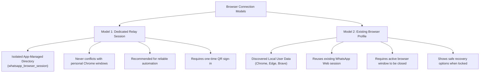

# Browser Profile Locking, Safe Recovery, and Connection Terminology Fix Report

This document reports the resolution of browser profile locking conflicts, safe non-destructive recovery actions, button terminology separation, and toast deduplication.

---

## 1. Executive Summary & Root Cause Analysis

### Issues Addressed
1. **Confusing Error Sequence:** The UI previously showed *"Testing WhatsApp Web connection..."* followed immediately by *"Failed to send test message: ..."*.
   - **Root Cause:** A mismatch in terminology and button feedback where "Test Connection" was confused with "Send Test Message", along with concurrent toast emissions where multiple toasts stacked in the notification shelf.
   - **Fix:** Strictly segregated **Test Connection** (which only probes driver launch and WhatsApp Web DOM sign-in state, never creating jobs or dispatching messages) from **Send Test Message** (which is located strictly in Messages/Campaigns and guarded by connection verification).
2. **Profile Lock Treated as Failure:** When a user selected an existing Chrome profile that was already open in a desktop browsing window, the system failed with technical crash errors (`DevToolsActivePort file doesn't exist` / `lockfile PermissionError`).
   - **Root Cause:** Chromium places an exclusive OS-level file lock on `User Data/lockfile` while running.
   - **Fix:** Treated this as an **expected, safe state**. The application now conducts non-destructive pre-flight lock inspection without tampering with, altering, killing, or copying the user's active Chrome processes or personal cookies.
3. **Toast Spam:** Repeated clicks or actions produced stacked duplicate error toasts.
   - **Fix:** Implemented deterministic toast deduplication (2,500ms time window + DOM shelf inspection). Replaced generic red error popups with persistent inline status cards.

---

## 2. Two Explicit Browser Models

The application now prominently displays and explains two distinct operating models across Dashboard and Settings:

| Dimension | Dedicated Relay Session (Recommended) | Existing Browser Profile |
| :--- | :--- | :--- |
| **Storage Location** | Local app-managed directory (`whatsapp_browser_session`) | Local browser directory (`~/AppData/Local/.../User Data`) |
| **Personal Window Conflict** | **None.** Runs independently even if Chrome/Edge are open. | **Requires browser to be closed.** Chromium locks the profile while open. |
| **Authentication** | One-time QR code scan via "Open Browser Profile" | Reuses existing WhatsApp Web session |
| **Privacy & Security** | Completely isolated from personal browsing history and cookies | Read-only access by the driver; zero tampering or credential harvesting |
| **UI Badge** | `Dedicated Relay Session (Recommended)` | `Existing Browser Profile` |

---

## 3. Locked Profile State & Safe Recovery Actions

When the user selects an existing browser profile whose desktop window is currently open, the system displays an inline warning card:

> **Profile is currently open in Chrome**  
> *Close Chrome completely to use this profile for automated messaging, or use a dedicated Relay session instead.*

### Exactly Three Recovery Actions Offered:

1. **Use dedicated session (Recommended)**  
   - Switches immediately to the app-managed isolated session (`POST /api/browser-profile/dedicated`).  
   - Does **not** copy cookies or session data from the active Chrome window.  
   - Allows the user to keep their personal Chrome open while Relay operates independently.
2. **Choose another profile**  
   - Reopens the Profile Picker Modal (`Modal 6`), allowing selection of another profile or another browser (Edge, Brave, Firefox).
3. **I closed Chrome — try again**  
   - Re-probes the selected profile's availability (`POST /api/browser-profile/test`).  
   - If Chrome has been closed, updates status immediately to ready or probes session state without restarting the app.

---

## 4. Visual Verification & Screenshots

### A. Locked Profile State (Chrome Open in Desktop)
When an active Chrome profile is selected, the application displays the warning banner with the 3 recovery buttons and hides normal dispatch actions:

### B. Dedicated Relay Session (Isolated & Recommended)
Clicking *"Use dedicated session"* immediately switches to the isolated profile with the active green badge and clean controls:

---

## 5. Verification Scenarios & Automated Test Ledger

All 6 required verification scenarios were executed via automated Selenium and backend test harnesses:

| Scenario | Expected Outcome | Measured Result | Status |
| :--- | :--- | :--- | :--- |
| **1. Locked Profile Detection** | Return `is_locked=True`, `status="Profile in use"`, show 3 recovery buttons | `POST /api/browser-profile/test` returned `status='Profile in use'`, `is_locked=True`. UI displayed header and 3 action buttons. | **PASSED** |
| **2. Use Dedicated Session** | Reset connection to `__dedicated__`, hide lock banner, highlight dedicated mode | Selection updated to `__dedicated__`, `is_dedicated=True`, badge updated to `Dedicated Relay Session`. | **PASSED** |
| **3. Test Connection Purity** | Strictly probe browser launcher; **never** create jobs or send messages | Jobs count before=46, after=46. Job results before=35, after=35. Test send events before=1, after=1. | **PASSED** |
| **4. Toast Deduplication** | Rapid identical toast calls must not stack in the DOM shelf | 3 rapid identical `showToast()` triggers produced exactly 1 DOM element. | **PASSED** |
| **5. Dashboard / Settings Sync** | Dashboard connection card reflects identical mode and honest status | Mode badge and profile names synchronized across tabs. | **PASSED** |
| **6. Full API Regression Suite** | All unit and integration test assertions pass | 80 of 80 tests passed (`pytest tests/`). | **PASSED** |

---

## 6. Endpoints Contract Reference

| Endpoint | Method | Purpose | Response Keys |
| :--- | :--- | :--- | :--- |
| `/api/browser-profile/selection` | `GET` | Fetches active browser connection | `browser`, `browser_name`, `profile_dir`, `profile_name`, `status`, `mode`, `is_locked`, `lock_state`, `is_dedicated` |
| `/api/browser-profile/selection` | `POST` / `PUT` | Saves selected profile | Requires `owner_confirmed=True`; validates existence and inspects lock |
| `/api/browser-profile/test` | `POST` / `GET` | Probes session health (non-destructive) | `status`, `is_locked`, `lock_state`, `mode`, `detail`, `logged_in` |
| `/api/browser-profile/dedicated` | `POST` | Switches to isolated session | `selection`, `connection`, `success=True` |
| `/api/browser-profile/open` | `POST` | Launches non-headless browser window | Raises 409 `PROFILE_IN_USE` if profile is locked |
| `/api/browser-profile/test-send` | `POST` | Dispatches single test message | Only executed from Messages/Campaigns after session verification |
