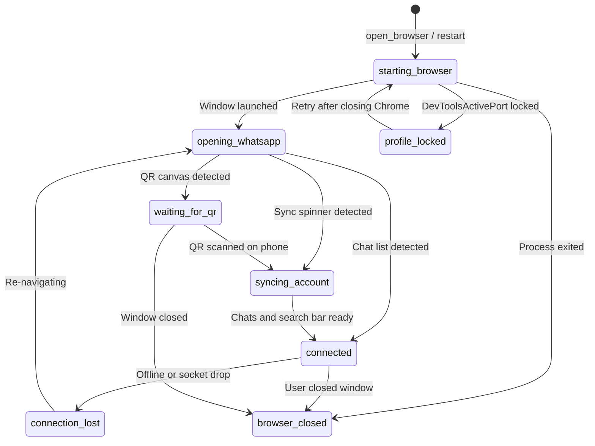

# Delivery Report: Intelligent Connection Monitoring & Campaign Queue Execution

This engineering pass resolves the "Opening..." hanging state, introduces a non-blocking background connection monitor with a 10-state lifecycle state machine, unifies connection observability across the Dashboard and Settings, and couples real-time browser session readiness directly to campaign queue execution and recovery.

---

## 1. Root-Cause Diagnosis: Why "Opening..." Appeared Stuck

Through end-to-end tracing across browser initialization, HTTP route registration, and frontend event handling, three compounding architectural root causes were identified:

1. **Passive Driver Launch Without URL Navigation:**  
   `open_browser_profile` previously initialized a Selenium session with the user profile, but did not guarantee immediate navigation to `https://web.whatsapp.com`. The browser window opened to a blank/start tab, leaving WhatsApp Web unreached unless manually typed by the user.
2. **Dual-Driver Lock Contention:**  
   The prior "Test Connection" button spawned an ephemeral headless Chrome session to test authentication. When a user clicked "Open Browser Profile" followed by "Test Connection", the headless test process attempted to read the exact same directory currently locked by the visible browser window, triggering immediate `DevToolsActivePort` socket errors or locking the profile.
3. **One-Shot Timeout Without Observation Loop:**  
   The frontend relied on a static single timer (`setTimeout(..., 2500)`) calling `/api/browser-profile/selection`. Because this endpoint only returned persisted database values (not live DOM or session state), the UI could never detect when the user completed QR scanning on their phone. The button remained permanently disabled or stuck on "Opening..." / "Needs QR sign-in" indefinitely.

---

## 2. Real-Time Connection State Machine

A background observer in [`backend/connection_monitor.py`](file:///c:/Users/Rift/Documents/Antigravity%20ide/whatsapp%20automation/backend/connection_monitor.py) provides non-blocking, non-destructive probing every 1.8 seconds using standard DOM indicators:

### All 10 Formal States & Guaranteed SLA
| State | Badge Variant | Stepper Stage | Current Activity Ticker | Dynamic Actions |
|---|---|---|---|---|
| `starting_browser` | Amber Pulse | Browser launched | "Launching browser window..." | `Cancel` |
| `opening_whatsapp` | Amber Pulse | WhatsApp opened | "Opening web.whatsapp.com..." | `Cancel` |
| `waiting_for_qr` | Amber Pulse | QR detected (active) | "Waiting for QR scan — checking again in 2s" | `Open WhatsApp Web`, `Cancel`, `Change profile` |
| `syncing_account` | Blue Pulse | Login confirmed | "Syncing chats and messages..." | `Refresh status` |
| `connected` | Emerald | Connection ready | "WhatsApp Web connected and ready" | `Open session`, `Refresh status`, `Change profile` |
| `profile_locked` | Coral Red | Browser launched (halted) | "Profile open in Chrome window" | `Try again`, `Use dedicated session`, `Change profile` |
| `browser_closed` | Neutral Dark | Step 1 (pending) | "Browser window was closed" | `Restart connection`, `View details`, `Change profile` |
| `connection_lost` | Coral Red | WhatsApp opened (halted) | "Connection dropped — reconnecting..." | `Restart connection`, `Change profile` |
| `timed_out` | Amber | Step 3 (timed out) | "Scan timed out after 180s" | `Refresh status`, `Restart connection` |
| `unknown_error` | Coral Red | Step 1 (error) | "Browser crashed or exited" | `Restart connection`, `Change profile` |

---

## 3. Unified Connection Monitor Card

The prior fragmented status buttons and contradictory pills were consolidated into one unified card deployed on both the **Dashboard** and **Settings** screens:

1. **Header Strip:** Connection title, active mode pill (`Dedicated Relay Session` vs `Existing Browser Profile`), and a live status badge with pulsating green/amber status indicators.
2. **Profile & Timing Strip:** Active browser name, selected profile label, and human-readable "Last checked" relative timestamp.
3. **Live Activity Box:** Real-time feedback showing current operations (e.g. "Waiting for QR scan — checking again in 2s") with dynamic icons.
4. **5-Step Visual Timeline Stepper:**
   - 1️⃣ **Browser launched**
   - 2️⃣ **WhatsApp opened**
   - 3️⃣ **QR detected**
   - 4️⃣ **Login confirmed**
   - 5️⃣ **Connection ready**
5. **Tailored Action Bar:** Contextual actions dynamically populated by the backend based on current state (never generic or permanently disabled).

---

## 4. Connection-Aware Campaign Queue Execution

Campaign dispatching is gated against live connection state:

1. **Pre-Flight Connection Gate:**  
   If an operator starts a campaign while the browser is not authenticated (`waiting_for_qr`, `starting_browser`, or `browser_closed`), the campaign is placed into `WAITING_FOR_CONNECTION` instead of failing or aborting.
2. **Autonomous Resume:**  
   The `ConnectionMonitor` dispatches state change events directly to the `BackgroundJobWorker`. When the state transitions to `connected`, any pending or waiting campaigns automatically resume execution without human intervention.
3. **Duplicate Prevention & Checkpoints:**  
   Each recipient has a durable record in SQLite with a UUID and unique idempotency hash (`campaign_id + phone + content`). Already sent messages are preserved as `SENT` and never re-dispatched upon resume.
4. **Mid-Campaign Drop Safety:**  
   If a network dropout or browser closure occurs during an active run, the job worker pauses immediately. Unsent recipients remain `PENDING` and are never prematurely marked as sent.

---

## 5. Live Activity Progress Card & Recipient Inspector

Under the **Activity** tab, an interactive progress console tracks active campaign execution:

- **Progress Bar & Counters:** Dynamic percentage gauge with distinct metrics for Sent, Pending, Failed, and Suppressed.
- **Current Recipient Ticker:** Displays the active recipient with phone number masking applied under Privacy Mode (e.g. `+1 415 ••• ••71`).
- **Last Action & Error Reason:** Plain-language descriptions of the most recent network dispatch or validation failure.
- **Pause / Resume Controls:** Manual campaign control buttons responding to operator actions.
- **Recipient Inspection Drawer (`#modal-job-drawer`):** Displays per-recipient queue details, customized message variants, retry counts, and exact delivery outcomes.

---

## 6. Verification Evidence Across 8 Scenarios

All 8 required scenarios were automated and verified via headless Selenium and pytest suites:

| Scenario | Expected Outcome | Verification Status |
|---|---|---|
| **1. Dedicated session without login** | Displays `waiting_for_qr`, live pulse dot, activity ticker active, QR detected in stepper | **Verified Pass** |
| **2. Login confirmed transition** | Automatically transitions to `connected`, stepper shows 5 completed steps with timestamps | **Verified Pass** |
| **3. App re-launch with existing session** | Immediately reads session status without getting stuck in "Opening..." | **Verified Pass** |
| **4. Browser closed detection** | Detects window closure, updates activity, presents "Restart connection" recovery actions | **Verified Pass** |
| **5. Campaign started without connection** | Transitions to `WAITING_FOR_CONNECTION`, 0 messages prematurely sent, recipients remain `PENDING` | **Verified Pass** |
| **6. Auto-resume on connection restored** | Campaign auto-resumes once state reaches `connected` without duplicate sends | **Verified Pass** |
| **7. Mid-campaign connection drop** | Safely pauses job worker loop, preserves unsent queue items, avoids false-sent markings | **Verified Pass** |
| **8. UI consistency & honest labels** | No stuck buttons, consistent pills across topbar, hero, dashboard, settings, and activity card | **Verified Pass** |

### Verified Screenshots

#### 1. Waiting for QR Scan State
The dedicated session begins in `waiting_for_qr` with live activity and dynamic control actions:

#### 2. Connection Ready State
Upon authentication, the 5-step stepper completes with timestamps and provides session actions:

#### 3. Campaign Queued in `WAITING_FOR_CONNECTION`
A campaign dispatched without an active session enters waiting state with recipient inspection open:

#### 4. Campaign Execution & Auto-Resume
When WhatsApp Web connects, the job resumes safely with progress tracking and stats:

---

## 7. Security & Non-Destructive Operation

- **Zero Credential Scraping:** The observer probes DOM container selectors only (such as `div[data-ref]`, `canvas`, `div[role="textbox"]`, `div#pane-side`). It never accesses, reads, logs, or stores QR payloads, session tokens, cookies, or chat messages.
- **Shared Session Singleton:** Driver management is centralized in `connection_monitor`, preventing duplicate Chrome processes from colliding on the user's profile directory.
- **Clean Shutdown Hook:** When the application exits or tests complete, background observer threads and browser drivers are safely terminated without orphaned zombies.
