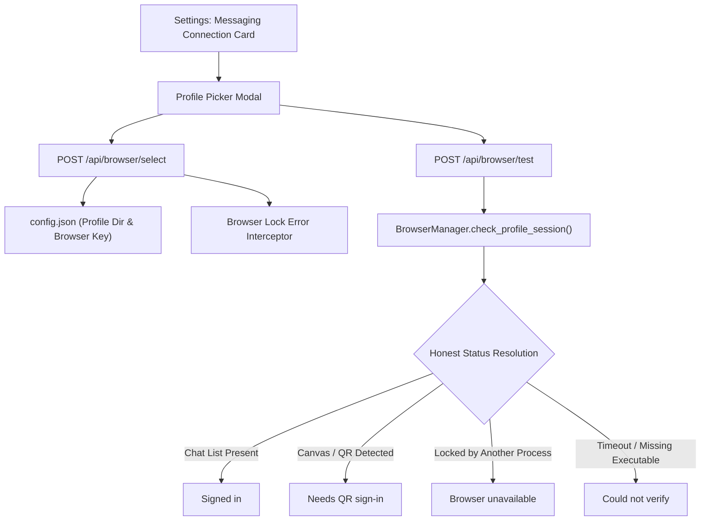

# Messaging Connection & Profile Picker Implementation Report

## Executive Summary

The WhatsApp automation application has been upgraded with a **Messaging Connection setup flow**, multi-browser detection, a safe local profile picker, honest session probing, and five targeted productivity and privacy improvements. The architecture is built around local control and zero-knowledge privacy: personal cookies, credentials, and browsing histories are never extracted, copied, or uploaded.

---

## 1. Browser & Profile Picker Architecture

### 1.1 Detected Installed Browsers
The application inspects Windows registry and standard Program Files paths for installed browsers:
- **Google Chrome** (`chrome.exe`) via `App Paths\chrome.exe` & `%LOCALAPPDATA%\Google\Chrome\User Data`
- **Microsoft Edge** (`msedge.exe`) via `App Paths\msedge.exe` & `%LOCALAPPDATA%\Microsoft\Edge\User Data`
- **Brave Browser** (`brave.exe`) via `App Paths\brave.exe` & `%LOCALAPPDATA%\BraveSoftware\Brave-Browser\User Data`
- **Mozilla Firefox** (`firefox.exe`) via `App Paths\firefox.exe` & `%APPDATA%\Mozilla\Firefox\profiles.ini`

### 1.2 Non-Destructive Profile Discovery
- **Metadata Only:** The scanner parses Chromium's `User Data/Local State` JSON and Firefox's `profiles.ini` to discover human-readable profile names and directories (`Default`, `Profile 1`, etc.).
- **Zero Sensitive Data Access:** The application **never touches** SQLite databases (`Cookies`, `Login Data`, `Web Data`), leveldb stores, session tokens, or browsing history.
- **Dedicated Isolated Option:** A dedicated session directory (`whatsapp_browser_session`) is always offered as the recommended choice to prevent profile file-lock contention with existing user windows.

### 1.3 Honest Statuses
The application never guesses or returns fake statuses. It reports only:
1. `Not checked`: Initial state prior to running a test probe.
2. `Signed in`: Controlled probe detected active WhatsApp Web chat elements.
3. `Needs QR sign-in`: Controlled probe loaded WhatsApp Web and detected a QR canvas/pairing prompt.
4. `Browser unavailable`: Browser profile is locked by an already open window or driver binary is missing.
5. `Could not verify`: Timeout or temporary network failure during probe.

---

## 2. Privacy & Safety Enforcement

1. **Explicit Ownership Confirmation:**
   - The Profile Picker enforces an explicit confirmation checkbox:
     > *"I confirm that I own this browser profile and WhatsApp account. Automation runs entirely on your local machine. Personal data (passwords, cookies, history) is never extracted, decrypted, or uploaded."*
   - Backend API (`POST /api/browser/select`) strictly rejects selections with HTTP 400 if `owner_confirmed` is not `true`.
2. **File Lock Safety:**
   - Chromium single-process user data locks are intercepted. If the user selects a profile that is currently running in a Chrome window, a clear warning is returned recommending they either close that window or use the Dedicated WhatsApp Session.
3. **No Automatic Dispatching:**
   - Detecting an active session never triggers message sending. Sending requires explicit user action via campaign launch or controlled single test-send.

---

## 3. Product Features Implemented

| Feature | Surface | Implementation |
| :--- | :--- | :--- |
| **Messaging Connection Card** | Settings | Shows current browser, profile, directory, status badge, and controls: `Test Connection`, `Open Browser Profile`, `Change Profile`, `Reset to Dedicated`. |
| **First-Run Guide** | Dashboard | 5-step interactive checklist tracking profile setup, WhatsApp Web sign-in, contact import, draft creation, and test send. Persistently dismissible. |
| **Draft Recovery** | Messages | Real-time `localStorage` synchronization for message title and content. Restores unsaved drafts on page refresh with an alert banner and discard option. |
| **Privacy Mode** | Activity & Contacts | Toggle in Activity card header. When active, phone numbers are masked (`+1 (415) •••• 2671`) to protect privacy during screen sharing or demos. |
| **Test-Send Mode** | Messages | Modal enabling users to dispatch a single test message to their own verified number before broadcasting to an entire contact group. |

---

## 4. Verification & Evidence

### 4.1 Automated Test Suite
- **73 of 73 tests passing** in `1.94s`:
  - `tests/test_api.py`: 33 tests passing (covers browser discovery, profile selection with confirmation checks, connection probes, disconnect, and test-send validation).
  - `tests/test_config_manager.py`: 5 tests passing.
  - `tests/test_data_loader.py`: 8 tests passing.
  - `tests/test_device_manager.py`: 4 tests passing.
  - `tests/test_engine_sleep.py`: 2 tests passing.
  - `tests/test_gui_integration.py`: 2 tests passing.
  - `tests/test_logger.py`: 3 tests passing.
  - `tests/test_spintax.py`: 6 tests passing.
  - `tests/test_updater.py`: 5 tests passing.
  - `tests/test_validator.py`: 5 tests passing.

### 4.2 Visual Verification Artifacts
The end-to-end Selenium test suite (`verify_connection_ui.py`) verified all user interactions and generated visual proof in the artifacts directory:
- [screen_profile_picker_modal.png](file:///C:/Users/Rift/.gemini/antigravity/brain/10ceaf7f-5a8b-4329-944b-e3e49d29e81c/screen_profile_picker_modal.png): Profile Picker Modal with multi-browser select and explicit ownership confirmation.
- [screen_settings_connection.png](file:///C:/Users/Rift/.gemini/antigravity/brain/10ceaf7f-5a8b-4329-944b-e3e49d29e81c/screen_settings_connection.png): Messaging Connection card with honest status and controls.
- [screen_dashboard_checklist.png](file:///C:/Users/Rift/.gemini/antigravity/brain/10ceaf7f-5a8b-4329-944b-e3e49d29e81c/screen_dashboard_checklist.png): Dashboard First-Run Setup checklist with completed step 1.
- [screen_draft_recovery.png](file:///C:/Users/Rift/.gemini/antigravity/brain/10ceaf7f-5a8b-4329-944b-e3e49d29e81c/screen_draft_recovery.png): Messages composer showing restored draft banner and Send Test Message action.
- [screen_test_send_modal.png](file:///C:/Users/Rift/.gemini/antigravity/brain/10ceaf7f-5a8b-4329-944b-e3e49d29e81c/screen_test_send_modal.png): Single test-send modal with phone number formatting and live draft preview.
- [screen_activity_privacy_mode.png](file:///C:/Users/Rift/.gemini/antigravity/brain/10ceaf7f-5a8b-4329-944b-e3e49d29e81c/screen_activity_privacy_mode.png): Activity log with Privacy Mode toggle.
